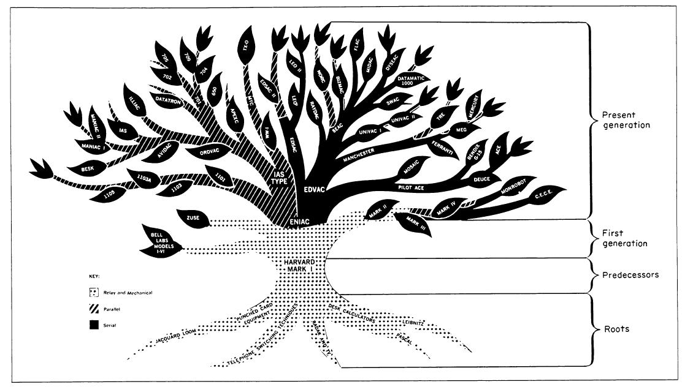

# 1. Historical Background

## 1.1 Architecture Name
EN - ENIAC (*Electronic Numerical Integrator and Computer*)

PT - ENIAC (Computador Integrador Numérico Eletrônico)

## 1.2 Year of Creation

> Descrição da Imagem: a imagem mostra a evolução de computadores ao longo do tempo por arquitetura, conforme as ramificações. O ENIAC, em questão, foi o predecessor das máquinas baseadas na Arquitetura de Von Neumann e sucessor das máquinas da Arquitetura Harvard.

Criado entre 1943 e 1945 pelos cientistas John Mauchly e J. Presper Eckert na Universidade da Pensilvânia, foi apresentado oficialmente em fevereiro de 1946.
## 1.3 Country

## 1.4 Inventor(s)

## 1.5 Organization / Company

## 1.6 Historical Context

What was happening in computing when this architecture appeared?

## 1.7 Problem to Solve

Which technological limitations motivated its creation?

## 1.8 Main Contributions

List the most important innovations.

## References
