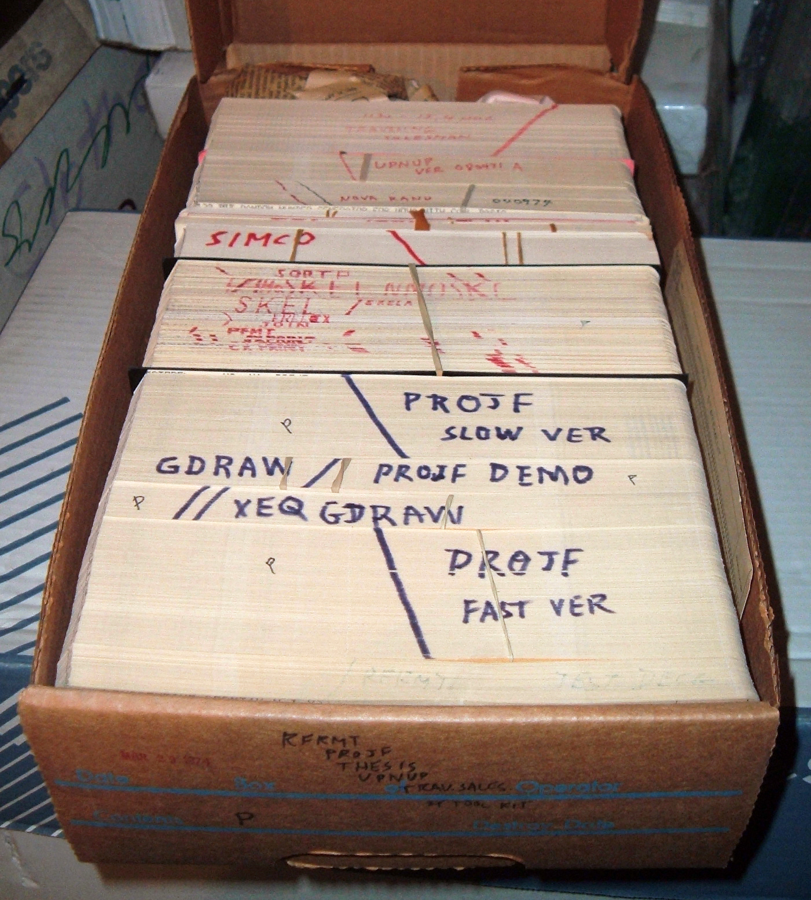
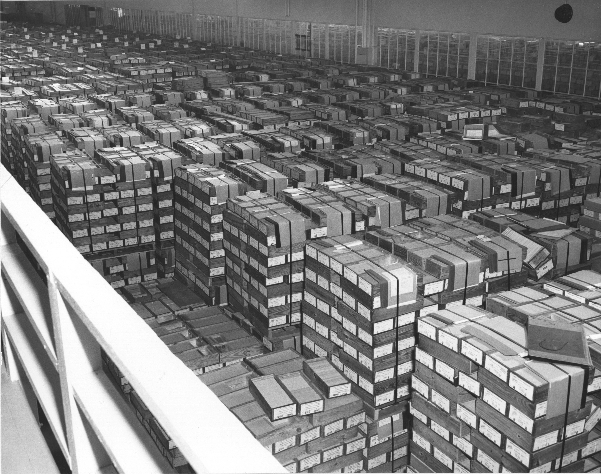
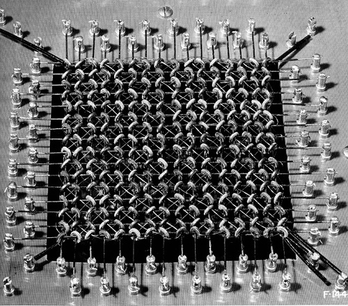

# 5. Memory Organization

> Descrição da Imagem: Fotografia exibindo uma operadora posicionada ao lado de uma imensa pilha de cartões perfurados. A estrutura, que atinge quase a altura dos ombros da operadora, é composta por aproximadamente 62.500 cartões de papel cartonado. A imagem ilustra muito bem o volume físico equivalente a 5 milhões de caracteres (cerca de 5 megabytes) de dados, o que correspondia à capacidade total de armazenamento dos primeiros discos magnéticos comerciais da época, como o IBM 305 RAMAC. Atrás da pilha é visível o que parece ser uma Keypunch (máquina de perfurar cartões). A imagem ajuda a visualizar a escala material do volume de dados, indiretamente expondo o extremo esforço logístico e espacial exigido para o manuseio das informações. Todo esse volume precisava ser fisicamente perfurado, rigorosamente ordenado para evitar falhas de sequência, transportado e alimentado em lotes nos leitores eletromecânicos para garantir a continuidade dos cálculos. Isso causava um gargalo que iremos tratar no tópico 9.5 do arquivo 09-performance.

## 5.1 Distributed Memory
O armazenamento de informações no ENIAC era fisicamente descentralizado, com a arquitetura da máquina não possuíndo um bloco de hardware unificado para reter dados e instruções simultaneamente. A retenção dos dados era categorizada pela natureza da informação e distribuída de forma independente pelas 40 unidades funcionais do sistema.

Os dados numéricos transitórios residiam nas próprias unidades de processamento. Os Acumuladores mantinham os operandos ativos diretamente em seus circuitos de contagem durante a execução das operações. Valores fixos e constantes matemáticas exigidas pelas equações eram configurados e retidos mecanicamente em matrizes de chaves rotativas nas Tabelas de Função (Function Tables) e na Unidade de Transmissão de Constantes (Constant Transmitter).

O armazenamento das instruções operacionais era estritamente topológico. A lógica de execução não existia como um conjunto de códigos numéricos salvos em uma matriz de válvulas. O programa executado durante uma operação da máquina era definido pelo arranjo dos cabos coaxiais interligados nas bandejas frontais e pela posição dos muitos interruptores nos painéis de controle das unidades. A configuração elétrica e mecânica do hardware constituía, na prática, a memória de instrução do sistema.

## 5.2 External Storage
A restrição física dos circuitos valvulados exigia o uso de cartões perfurados padrão IBM como a mídia exclusiva de armazenamento de massa não-volátil do sistema. Os cartões funcionavam como um repositório estático. Tabelas de tiro balístico, parâmetros de calibração e operandos iniciais eram registrados mecanicamente através de furos no papel cartonado, preservando as informações de forma permanente desde que a integridade física do material e a ordenação do lote fossem mantidas.

> Nota: Armazenamento de massa refere-se a mídias capazes de reter (relativamente) grandes volumes de dados externamente aos circuitos principais. Não-volátil indica que a retenção da informação não depende de energia elétrica; uma vez perfurados, os dados permanecem gravados no papel indefinidamente, independentemente de a máquina estar ligada ou desligada (diferente dos valores intermediários, que dependiam de haver energia correndo pela máquina para continuarem acessíveis).

Cada cartão abrigava 80 colunas, o que corresponde matematicamente a 80 caracteres (ou 80 bytes de dados não compactados). Para lidar com o volume de milhares de cartões, os lotes eram guardados em gaveteiros metálicos modulares alocados na sala de operações. A manutenção desse arquivo exigia controle rigoroso do ambiente onde eles se encontravam, pois variações de umidade dilatavam ou deformavam o papel cartonado, causando atolamentos e desalinhamentos no cilindro eletrificado do leitor. Em termos de capacidade física, uma caixa contendo 12.500 cartões perfurados equivalia a aproximadamente 1 megabyte de informação.

> Descrição da Imagem: Fotografia de uma caixa de papelão contendo aproximadamente 2.000 cartões perfurados agrupados em lotes. Considerando a capacidade cada cartão, o volume total desta caixa representa cerca de 160 kilobytes. Na face superior dos maços, destacam-se anotações de identificação e linhas diagonais contínuas desenhadas com marcador. Essas marcações além de aturarem como um mecanismo de segurança também serviam para separar diferentes grupos de cartões (como se fosse uma indexação dos dados em uma coordenada da memória externa). 

A natureza não-destrutiva da leitura eletromecânica permitia a reutilização contínua dos mesmos lotes de dados. Em problemas de integração numérica ou equações diferenciais que exigiam múltiplas iterações sobre as mesmas variáveis, a equipe recolhia a pilha ejetada no empilhador do Leitor de Cartões e a realimentava no compartimento de entrada. Esse ciclo de reintrodução posicionava os cartões como uma memória estática de leitura repetitiva.

Esse meio também atuava como uma expansão do armazenamento temporário para contornar o esgotamento dos contadores internos. Quando um problema matemático complexo gerava uma quantidade de resultados intermediários superior ao número de Acumuladores disponíveis, a máquina acionava a perfuradora periférica para descarregar esses valores elétricos em cartões virgens. Posteriormente, a equipe reintroduzia essa pilha de resultados parciais no Leitor de Cartões para dar prosseguimento à equação, utilizando o papel como um mecanismo externo de armazenamento auxiliar para leitura e escrita cíclica.

> Descrição da Imagem: Fotografia do Centro de Registros Federais em Alexandria (1959), evidenciando o volume do armazenamento de massa não-volátil em larga escala. A instalação abrigava dezenas de fileiras de paletes empilhados, contendo milhares de caixas. Há aproximadamente 20 fileiras de paletes, cada fileira sendo 15 palets de largura e 2 de altura (~600 palets). Cada palet guardava 45 caixas de 2.000 cartões cada (54 Milhões de cartões no total). Multiplicando a quantidade de cartões por quantos caracteres cada um armazena (54 milhões x 80), o galpão inteiro armazena aproximadamente 4,32 bilhões de caracteres (equivalente a 4,3 gigabytes). (Os data centers da época, como todo o esforço do mundo, tinham uma capacidade de armazenamento quase que inusável para uma única pessoa atualmente...)

## 5.3 Read/Write Memory (Accumulators)
- Como os 20 acumuladores funcionavam como resgistradores temporários/RAM

## 5.4 Read-Only Memory (Function Tables)
- Painéis de interruptores manuais para armazenar constantes/valores fixos

## 5.5 Decimal Ring Counters
- Como funcionava a configuração dos tubos usados para armazenar números de base 10

## 5.6 Decimal Representation
- Como os dados eram armazenados usando contadores em anel (base 10, não binária)

## 5.7 Memory Capacity

O ENIAC não tinha uma memória única. Tinha vários tipos de armazenamento, cada um com capacidade diferente. 
Uma observação importante é que a máquina sofreu alterações estruturais ao longo dos anos, sendo que em 1948 houve uma reconfiguração da montagem original de 1946, e em 1953 foi instalada a memória de núcleo 

### 5.7.1 Acumuladores (memória eletrônica)

Eram 20 acumuladores, cada um guardando um número de 10 dígitos decimais mais o sinal. Isso soma um total de 200 dígitos decimais. Com codificação cuidadosa, um acumulador podia guardar, por exemplo, dois números de 5 dígitos.
No Converter Code de 1951, nem todos os acumuladores eram livres para dados. Alguns serviam de contador de programa, de acumulador principal e assim por diante. Existindo um total de 13 acumuladores utilizáveis sem restrição.
Em uma conversão simples, esses 200 dígitos decimais equivalem a algo na ordem de 700 bits, ou cerca de 85 bytes. Como o ENIAC era decimal, essa conversão serve apenas como uma mensura básica.

### 5.7.2 Tabelas de função (memória fixa):

Eram 3 tabelas na configuração original, utilizadas apenas para leitura durante as operações do sistema, contendo 104 linhas cada. Cada linha guardava 12 dígitos e 2 sinais, e o conteúdo era ajustado manualmente em chaves rotativas de 10 posições de acordo com a necessidade de operçaão.
Contendo no total 312 linhas, ou cerca de 3.744 dígitos na configuração de 1951–1955. Essa quantidade massiva e programável de variaveis era de suma importância para que contas mais complexas pudessem ser feitas com uma menor necessidade de configuração fisíca de cabos e bandejas.

### 5.7.3 Transmissor de constantes e cartões (memória intermediária):

Uma fileira de relés guardava o conteúdo de um cartão inteiro. Cada cartão carregava 8 números de 10 dígitos com sinal, ou seja, 80 dígitos. Além disso, haviam 2 linhas de 10 dígitos (campos J e K) ajustadas por chaves, complementando os dados repassados pelo cartão. Os cartões perfurados funcionavam como armazenamento externo, praticamente ilimitado, já que bastava ter mais cartões. Sendo limitados apenas pela sua necessidade de inserção fisíca, que o impedia de ler constantemnete cartões novos. Paralelamente, era muito comum o uso de cartões que haviam sido utilizados como Output de uma operação passada, como Input para uma nova operação usando os resutaldos gerados como base.

### 5.7.4 Memória de núcleo magnético (adicionada em 1953):

O projetista, Isaac Auerbach, da Burroughs, apontou um problema, o ENIAC tinha só 20 palavras de memória interna, os acumuladores. Isso limitava o tamanho dos problemas que podiam ser programados sem consultar repetidamente a memória externa de cartões perfurados. Nesse caso a solução foi acrescentar 100 palavras de acesso rápido. O princípio era simples mas inovador, um núcleo é um pequeno anel (“rosquinha”) de material magnético que pode ser magnetizado em um de dois sentidos, e cada sentido representa um 0 ou um 1. Como o estado depende do magnetismo, a informação não se perde quando a energia cai. No projeto feito pela Burroughs, cada bit usava um núcleo com dois enrolamentos e um diodo de germânio. A força magnética aplicada era sempre suficiente para virar o núcleo, ou seja, o sistema não dependia da intensidade do sinal. Os dados entravam e saíam em paralelo, a palavra inteira de uma vez. A matriz tinha cerca de 4.100 elementos magnéticos para 100 palavras de 10 dígitos decimais mais uma unidade de sinal.
Cada dígito decimal era guardado em 4 bits, representando o dígito somado a 3. Assim, 0 vira 3 (0011), 5 vira 8 (1000) e 9 vira 12 (1100). Isso é chamado de decimal codificado em binário (BCD) com excesso de 3. O ENIAC continuava decimal por dentro, e a memória de núcleo era um módulo binário acoplado a ele. Isso foi a base utilizada para a codificação excess-3.
Para acoplar o módulo, o ENIAC recebeu um novo seletor de tabelas de função, um seletor de endereços de memória e circuitos de modelagem de pulso. Também foram acrescentadas três novas ordens ao Converter Code.

## 5.8 Access Speed

Como já citado antes, a unidade de tempo do sistema era o relógio (clock) que agia em 100 kHz, e uma “add time” (tempo de adição) equivalia a 20 pulsos, ou 200 µs. Essa é a unidade de referência para os demais tempos.

### 5.8.1 Acumuladores:

Ler, escrever ou somar um número levava uma add time, 200 µs. Igualmente, a memória de tubos (20 palavras) tinha acesso de 200 µs. Assim mantendo a sincronia do clock e dos pulsos.

### 5.8.2 Núcleo magnético:

Acesso de 200 µs para as 100 palavras, o mesmo tempo dos acumuladores, e era isso que tornava os núcçeos magnéticos tão uteis. A capacidade de leitura era cinco vezes maior quando implememtada por eles.

### Cartões perfurados:

Aqui é onde se encontra um dos princiapis gargalos funcionais do Eniac. O leitor lia 125 cartões por minuto e a perfuradora gravava 100 por minuto. O que leva a estimativa de 0,48 segundos por cartão lido e 0,6 segundos por cartão perfurado. Se considerar que um comando de impressão levava entre 1.000 e 3.000 add times, ou seja, de 0,2 a 0,6 segundos, chegamos a conclusão que toda essa operação é milhares de vezes mais lenta que o acesso eletrônico. Por isso, quase qualquer problema real ficava limitado pela entrada/saída, e não pelo cálculo.

## 5.9 1953 Upgrade
- Adição posterior de memória de núcleo magnético

## 5.10 Modern Comparison
- Como as formas de memória do ENIAC se compara as formas de memória atuais

| ENIAC memory | Modern memory |