# 6. Data Flow and Access

## 6.1 Data Origins

No ENIAC, os operandos não eram obtidos a partir de uma memória central endereçável como ocorre em computadores modernos. A máquina não possuía uma RAM central na qual cada valor pudesse ser localizado por meio de um endereço. Em vez disso, os dados permaneciam armazenados nas próprias unidades funcionais e eram transferidos entre elas por meio de conexões físicas configuradas previamente.

Duas situações são especialmente importantes para compreender a origem dos operandos: a introdução de constantes pelo **Constant Transmitter** e a utilização de resultados produzidos anteriormente durante o processamento.

### 6.1.1 Constant Transmitter

O **Constant Transmitter** era uma unidade utilizada para fornecer valores constantes ao restante do ENIAC. Ele podia receber números provenientes do sistema de entrada, como cartões perfurados, além de permitir a configuração manual de valores.

O Constant Transmitter, portanto, funcionava como uma das fontes de operandos da máquina. Seu papel não era equivalente ao de uma RAM moderna: ele fornecia valores previamente configurados para que outras unidades pudessem utilizá-los durante a execução.

### 6.1.2 Resultado de uma operação anterior

Outra origem importante dos operandos era o próprio processamento do ENIAC. Os **Acumuladores** combinavam armazenamento e operações aritméticas. Dessa forma, o resultado produzido por uma operação podia permanecer armazenado em um acumulador e posteriormente ser transmitido para outra unidade.

Por exemplo, considerando dois acumuladores:

```text
Accumulator A = 15
Accumulator B = 27
```

uma operação de adição poderia produzir:

```text
15 + 27 = 42
```

O valor `42` passava então a estar armazenado no acumulador de destino. Esse resultado poderia ser utilizado como operando em uma operação posterior:

```text
Operação 1
15 + 27
   │
   ▼
  42
   │
   ▼
armazenado no acumulador
   │
   ▼
Operação 2
42 + outro valor
```

Esse mecanismo permite compreender uma característica fundamental da arquitetura do ENIAC: os resultados intermediários não precisavam ser imediatamente enviados para uma memória externa. Eles podiam permanecer nas unidades que participavam diretamente do processamento e posteriormente ser transmitidos por meio das conexões configuradas.

Portanto, a origem de um operando no ENIAC estava relacionada à própria organização física da máquina: um valor poderia ser fornecido por uma unidade de entrada/constantes ou ser resultado de uma operação anterior armazenado em uma unidade funcional.

---

## 6.2 Data Movement Process

Depois que um número estava disponível em uma unidade de origem, era necessário transportá-lo até a unidade que executaria a próxima operação. No ENIAC, essa comunicação era realizada por meio de **Digit Trays**, conjuntos de linhas de transmissão que percorriam fisicamente os painéis da máquina.

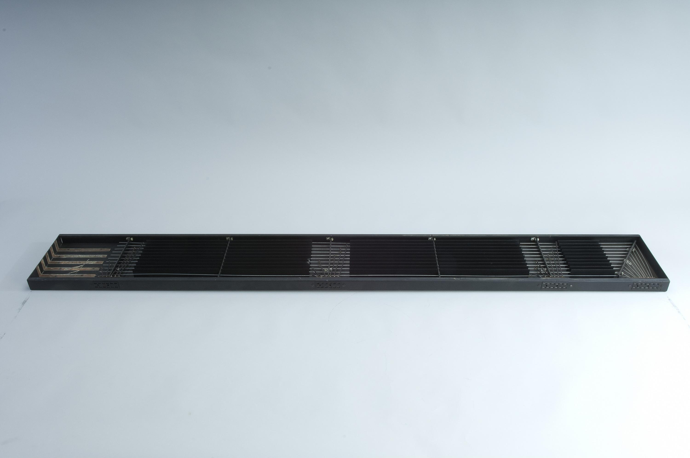

> Descrição da Imagem: Digit Tray do ENIAC. Bandeja física utilizada para interconectar unidades do ENIAC por meio de linhas condutoras. O componente possuía onze linhas de transmissão associadas ao transporte dos dados numéricos e do sinal. Fonte: National Museum of American History, Smithsonian Institution.

As Digit Trays eram responsáveis pelo transporte dos sinais que representavam os dados numéricos. Elas eram diferentes das **Program Trays**, utilizadas para transportar os pulsos de controle responsáveis por coordenar a sequência das operações.

### 6.2.1 Conexão física entre as unidades

O ENIAC utilizava conexões físicas para determinar quais unidades poderiam trocar dados. Cabos conectavam as entradas e saídas dos acumuladores às linhas presentes nas Digit Trays. Uma Digit Tray podia ser conectada a diferentes entradas e saídas. O comportamento efetivamente utilizado durante uma operação dependia da configuração dos circuitos de controle e do momento em que os pulsos eram enviados.

Essa arquitetura era bastante diferente de um computador moderno. Em vez de uma instrução indicar um endereço de memória de origem e outro de destino, a própria montagem física da máquina estabelecia os caminhos pelos quais os dados poderiam circular.

### 6.2.2 Transmissão dos dígitos

O ENIAC utilizava representação decimal. Cada acumulador armazenava seus números utilizando décadas, e cada década utilizava um contador de anel para representar um dos dez possíveis algarismos, de `0` a `9`. Quando um acumulador precisava transmitir seu conteúdo, seus circuitos de transmissão utilizavam os pulsos de temporização da máquina para transformar o estado armazenado em uma sequência de pulsos elétricos.

O número, portanto, não era transportado pelo cabo como uma sequência de bits armazenados em uma memória. O que percorria a bandeja eram **sinais elétricos temporizados**, cuja sequência representava os dígitos do número.

### 6.2.3 Recepção no destino

Na unidade de destino, os pulsos recebidos eram encaminhados para os circuitos de entrada correspondentes. No caso de um acumulador, esses pulsos podiam alterar os contadores de anel e, dependendo da configuração da operação, adicionar ou subtrair o valor recebido do conteúdo já armazenado.

### 6.2.4 Controle e sincronização

A transferência dos dados não acontecia de maneira independente do restante da máquina. O ENIAC era um sistema síncrono, coordenado pelos pulsos produzidos pela **Cycling Unit**. O ciclo básico de operação tinha duração de aproximadamente 200 microssegundos, e os pulsos de temporização eram utilizados para coordenar as diferentes unidades.

Assim, é importante distinguir:
- **Digit Trays:** transportavam os dados numéricos;
- **Program Trays:** transportavam os sinais de controle da programação;
- **Cycling Unit:** fornecia a temporização que sincronizava as operações.

Essa separação permitia que uma unidade soubesse não apenas **qual dado** deveria receber ou transmitir, mas também **quando** a transferência deveria ocorrer.

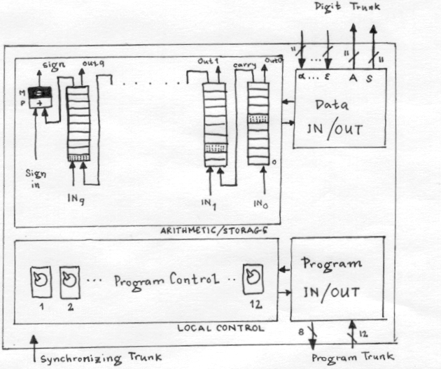

> Descrição da Imagem: Diagrama esquemático de um Acumulador do ENIAC, mostrando como essa unidade armazenava números e se comunicava com outras partes da máquina. Na parte superior, aparecem os circuitos que representam e armazenam os algarismos do número, além das entradas e saídas utilizadas para receber e transmitir dados. À direita, o bloco Data IN/OUT conecta o acumulador ao Digit Trunk, conjunto de linhas elétricas usado para transportar os números entre as unidades; as entradas α, β, γ, δ e ϵ recebem dados, enquanto A e S permitem transmitir o valor para operações de adição ou subtração. Na parte inferior, os controles de programa determinam quando essas operações devem ocorrer, utilizando o Program Trunk para transmitir os sinais de controle. O diagrama também mostra o Synchronizing Trunk, responsável por fornecer os sinais que mantêm as operações da máquina sincronizadas.

## 6.3 Intermediate Results

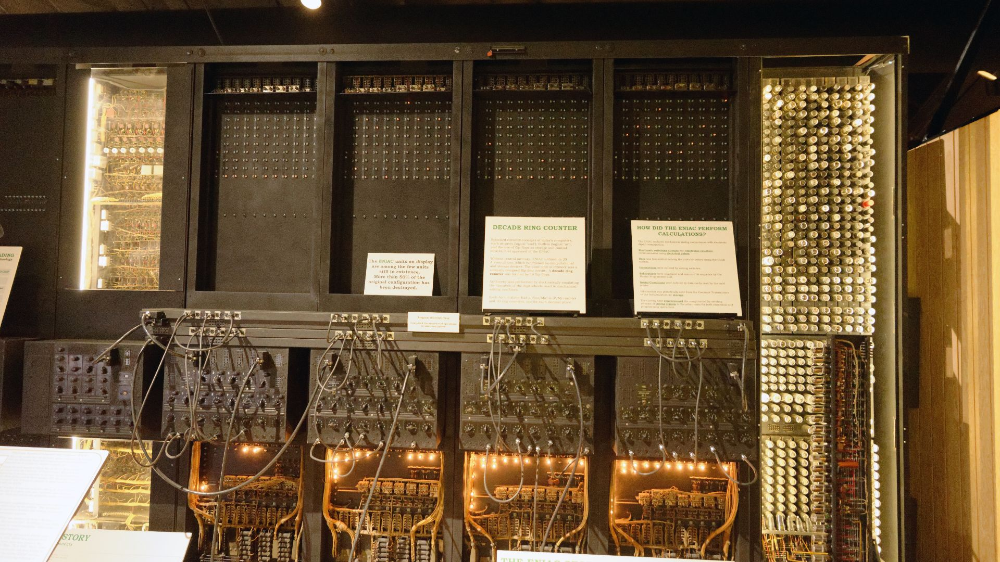

> Descrição da Imagem: Fotografia de painéis de Acumuladores do ENIAC preservados em exposição. O topo exibe as matrizes de lâmpadas neon dos contadores de anel decádicos (0 a 9). Na seção central e inferior, observam-se as calhas horizontais com cabos de manobra, as chaves rotativas de controle de programa e a fiação interna exposta na base. Na direita há um chassi aberto evidenciando a densa matriz de válvulas termiônicas que compunha os circuitos das unidades.

A retenção de resultados parciais ocorria diretamente nos Acumuladores, eliminando o roteamento constante de dados para a memória externa. Ao finalizar uma etapa matemática, como uma adição ou a recepção de um produto parcial de um multiplicador, o valor recém-calculado permanecia gravado eletricamente no próprio hardware sem depender de ciclos de processamento contínuos.

### 6.3.1 Vacuum Triodes

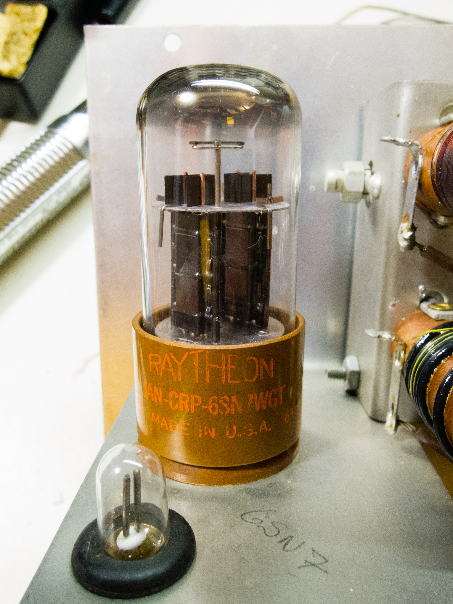

> Descrição da Imagem: Foto de uma válvula duplo-tríodo 6SN7 (Raytheon JAN-CRP-6SN7WGT). É possível ver as duas estruturas internas paralelas contendo as placas, grades de controle e cátodos dos dois tríodos encapsulados. Em primeiro plano, à esquerda, destaca-se a lâmpada neon com seus dois eletrodos cilíndricos internos, responsável pela sinalização visual de condução do circuito biestável, ao lado da identificação "6SN7" anotada na chapa metálica.

Para compreender como um valor era mantido eletricamente, é necessário analisar o funcionamento do tríodo, a válvula termiônica básica do sistema. Um tríodo consiste em um tubo de vidro selado a vácuo contendo quatro componentes internos principais:

1. Filamento: Uma resistência elétrica que se aquece com a passagem de corrente, funcionando de maneira semelhante ao filamento de uma lâmpada incandescente.
2. Cátodo: Um pequeno cilindro metálico posicionado ao redor do filamento. Quando aquecido, o metal do cátodo libera elétrons livres no vácuo, um fenômeno físico chamado emissão termiônica. Como os elétrons possuem carga elétrica negativa, eles formam uma nuvem ao redor do cilindro.
3. Placa (Ânodo): Uma lâmina de metal posicionada na extremidade oposta do tubo, polarizada com alta tensão elétrica positiva. Pela lei da atração eletrostática, cargas opostas se atraem: a placa positiva atrai os elétrons negativos emitidos pelo cátodo, criando um fluxo contínuo de corrente elétrica através do vácuo.
4. Grade de Controle: Uma malha fina de fios metálicos posicionada fisicamente entre o cátodo e a placa, por onde os elétrons precisam passar.

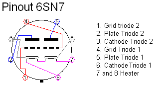

> Descrição da Imagem: Diagrama esquemático de pinagem da válvula duplo-tríodo 6SN7 em base octal de oito pinos. O esquema mapeia os eletrodos independentes dos dois tríodos encapsulados. O Tríodo 1 conecta-se aos pinos 4 (grade de controle), 5 (placa) e 6 (cátodo), enquanto o Tríodo 2 utiliza os pinos 1 (grade de controle), 2 (placa) e 3 (cátodo). Os pinos 7 e 8 são dedicados à alimentação elétrica do filamento de aquecimento compartilhado, permitindo a montagem compacta do circuito biestável em um único soquete.

A grade de controle funciona como uma comporta eletrônica para o fluxo de elétrons, operada pela variação de sua voltagem entre dois estados:

- Estado de Corte: Quando uma tensão fortemente negativa é aplicada à grade, sua carga repele os elétrons que tentam sair do cátodo (pois cargas iguais se repelem). O fluxo de partículas é fisicamente bloqueado antes de atingir a placa. Dessa forma a válvula entra em estado de corte, onde nenhuma corrente elétrica circula pelo circuito da placa.
- Estado de Saturação: Quando a tensão da grade é elevada (tornando-se nula ou positiva em relação ao cátodo), a barreira de repulsão desaparece. Os elétrons atravessam livremente as aberturas da grade e colidem em alta velocidade contra a placa. A válvula entra em estado de condução/saturação, onde a corrente elétrica flui livremente pelo circuito.

A válvula 6SN7, amplamente empregada no ENIAC, era um duplo-tríodo, ou seja, ela agrupava dois desses conjuntos completos de cátodo, grade e placa dentro de um único invólucro de vidro.

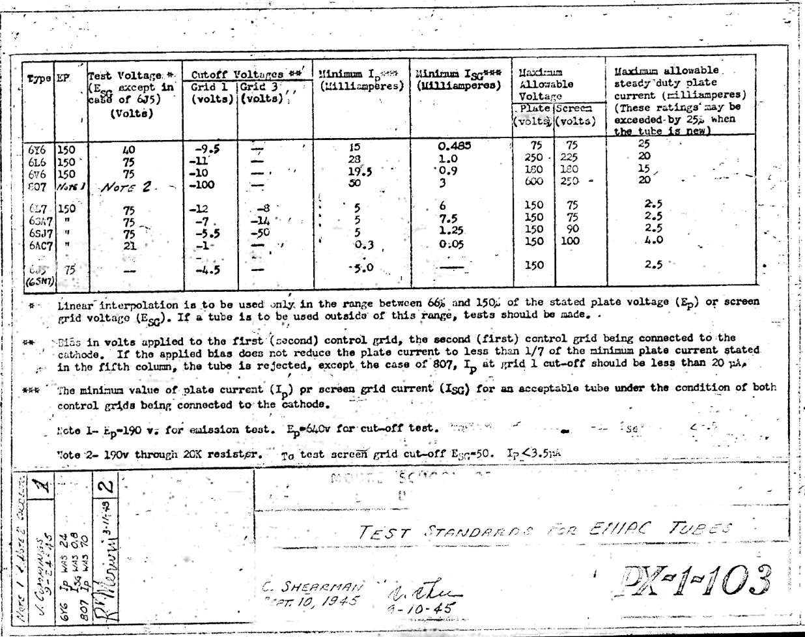

> Descrição da Imagem: Documento técnico oficial PX-1-103 da Moore School of Electrical Engineering, datado de 10 de setembro de 1945, intitulado "Test Standards for ENIAC Tubes". A tabela estabelece os critérios elétricos padronizados de teste e rejeição de válvulas para garantir a confiabilidade dos circuitos da máquina. Na última linha da tabela, destacam-se os parâmetros de homologação para o duplo-tríodo 6SN7: tensão de corte da grade de controle (Cutoff Voltage Grid 1) fixada em -4,5 V, corrente mínima de emissão de placa em 5,0 mA para uma tensão de teste de 75 V, e limite máximo de corrente contínua de trabalho em 2,5 mA. As notas de engenharia na base definem o protocolo de corte: qualquer válvula cuja corrente de placa não caísse para menos de 1/7 do valor mínimo sob polarização negativa de grade era imediatamente rejeitada, impedindo que vazamentos de elétrons desestabilizassem o travamento dos circuitos biestáveis.

### 6.3.2 Bistable Circuits
O armazenamento de um estado elétrico dependia da união de dois tríodos em um circuito biestável, também conhecido como gatilho Eccles-Jordan ou flip-flop. Esse circuito foi projetado para possuir dois estados estáveis de repouso, utilizando a técnica de realimentação por acoplamento cruzado.

No circuito biestável, a placa do primeiro tríodo (Tríodo A) é ligada diretamente à grade de controle do segundo tríodo (Tríodo B) através de uma rede de resistores. De forma idêntica e cruzada, a placa do Tríodo B é ligada de volta à grade de controle do Tríodo A. Esse circuito opera em um equilíbrio auto-sustentável baseado na queda de tensão elétrica:

Quando uma corrente elétrica passa por um resistor ligado à placa de um tríodo em condução, ocorre uma queda abrupta na voltagem dessa placa (a tensão cai para um nível baixo). Se o Tríodo A entra em condução (saturação), a baixa tensão de sua placa é conduzida diretamente para a grade do Tríodo B. Essa baixa voltagem empurra a grade do Tríodo B para um potencial altamente negativo, forçando o Tríodo B a entrar em corte (bloqueando sua condução de elétrons). Como o Tríodo B não conduz corrente, não há queda de tensão em sua placa. A placa do Tríodo B permanece com sua voltagem máxima positiva. Essa alta tensão da placa de B é conduzida de volta para a grade do Tríodo A, mantendo a grade de A positiva e sustentando a condução de elétrons em A.

Os dois tubos travam-se mutuamente nesse estado. O Tríodo A permanece indefinidamente em condução contínua e o Tríodo B permanece indefinidamente bloqueado, sustentados apenas pelas linhas de corrente contínua da fonte de alimentação, sem necessitar de pulsos externos para manter a informação guardada. O circuito só inverte essa condição quando recebe um pulso elétrico deliberado em sua entrada, forçando o Tríodo A a cortar e o Tríodo B a conduzir.

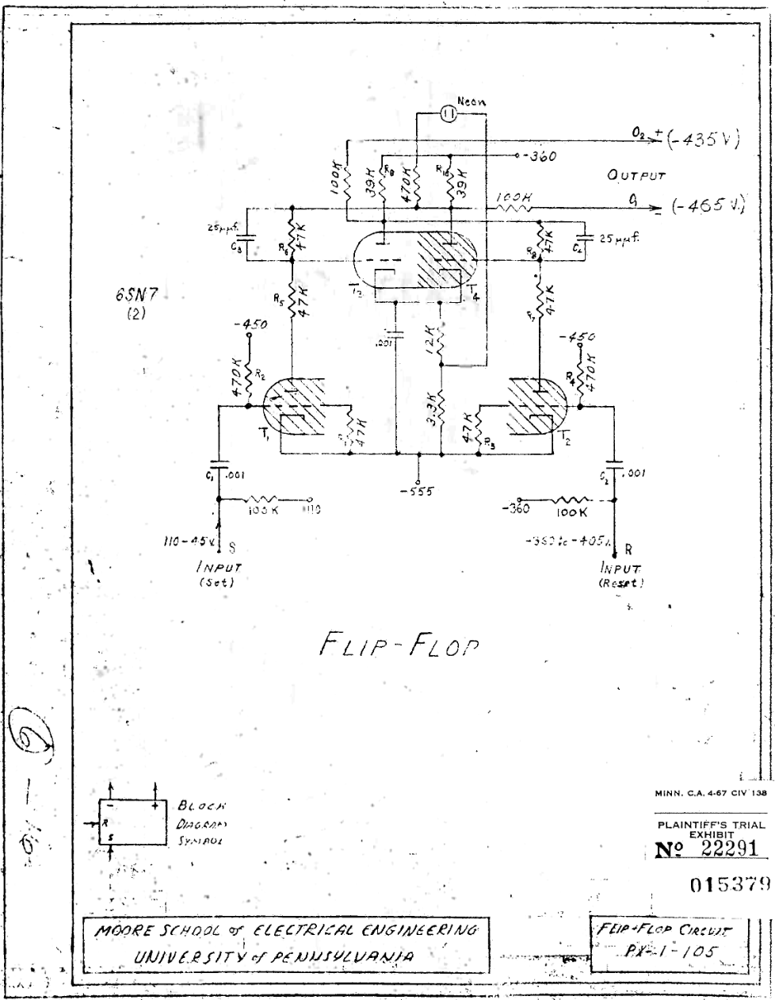

> Descrição da Imagem: Documento técnico original PX-1-105 da Moore School of Electrical Engineering (Universidade da Pensilvânia), intitulado "Flip-Flop Circuit". O esquema detalha a arquitetura elétrica do circuito biestável (gatilho Eccles-Jordan) construído com válvulas duplo-tríodo 6SN7, utilizado como a unidade fundamental de retenção de estado nos acumuladores do ENIAC. No centro, observa-se o circuito de acoplamento cruzado: a placa de cada tríodo é ligada diretamente à grade do tríodo oposto através de divisores resistivos de 47 kΩ em paralelo com capacitores de comutação rápida de 25 pF (C3 e C4), estabelecendo o laço de realimentação contínua que mantém um tubo em condução e o outro em corte. O circuito é alimentado por linhas de corrente contínua com tensões de polarização fixadas em -360 V, -450 V e -555 V. Na seção inferior, destacam-se os terminais de entrada de pulsos: "INPUT (Set)" à esquerda para comutar o circuito e "INPUT (Reset)" à direita para forçar o retorno ao repouso. No canto superior direito, a linha de saída ("OUTPUT") extrai os níveis diferenciais de tensão contínua (-435 V e -465 V) para leitura não destrutiva, ladeada por uma lâmpada neon que fornecia indicação luminosa direta do estado ativo na face do painel. No canto inferior esquerdo, o desenho inclui o símbolo padronizado do bloco biestável utilizado nos diagramas lógicos gerais da máquina.

### 6.3.3 Ring Counters

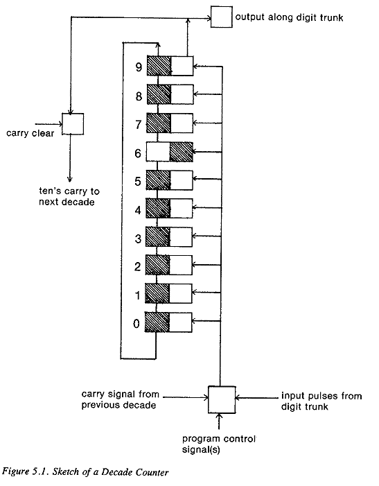

> Descrição da Imagem: Diagrama simplificado de um contador de anel decádico do ENIAC. O diagrama ilustra a disposição vertical dos dez estágios biestáveis (numerados de 0 a 9) que formam uma única casa decimal. Cada bloco é dividido em duas metades para indicar o estado de condução dos tríodos: os estágios de 0 a 5 e de 7 a 9 encontram-se em estado de repouso (marcado à esquerda), enquanto o estágio 6 apresenta o estado invertido/ativado (marcado à direita), representando a retenção do número decimal 6. A linha condutora externa à esquerda conecta a saída do estágio 9 de volta ao estágio 0. Na base, o bloco de controle recebe os pulsos de dados dos troncos de digitos, os sinais de controle de programa e o pulso de transporte da década anterior, acionando a linha comum de avanço vertical. No topo, a transição entre o estágio 9 e o estágio 0 aciona as comportas superiores, direcionando o pulso de transporte de dezenas para a década seguinte à esquerda ("ten's carry to next decade") e liberando a transmissão dos dados calculados para o barramento ("output along digit trunk").

Para armazenar e operar números decimais, os biestáveis eram organizados em contadores de anel decádico. Cada anel representava uma única casa decimal (unidades, dezenas, centenas) e era formado por dez circuitos biestáveis interligados em uma fila circular fechada (circular no sentido de que após o nove vinha o número 0, não literalmente circular), numerados de 0 a 9. O terminal de saída do estágio 9 era conectado diretamente de volta à entrada do estágio 0, fechando o anel.

A representação do número dentro de cada década era puramente posicional, sendo que dentro dos dez estágios do anel, nove biestáveis permaneciam em repouso (repouso = Tríodo A conduzindo e Tríodo B em corte) e apenas um biestável permanecia ativado (ativado = Tríodo A em corte e Tríodo B conduzindo). O valor numérico correspondia à posição física do estágio ativado, por exemplo: Se o estágio 0 estivesse ativado, a década armazenava o número 0; Se o estágio 7 estivesse ativado e todos os outros nove em repouso, a década armazenava o número 7.

Para avançar o contador, todos os dez biestáveis do anel compartilhavam uma única linha comum de entrada de pulsos elétricos. O circuito funcionava por transferência de carga entre vizinhos. Quando um pulso de 100 kHz entrava na linha comum, ele atingia todos os dez biestáveis, mas apenas o estágio que já estava ativado possuía polarização para reagir. Esse pulso forçava o estágio ativado a desligar (revertendo seus tríodos ao estado de repouso). Ao desligar, a placa do seu tríodo sofria uma rápida elevação de tensão. Essa variação era canalizada por um pequeno capacitor ligado diretamente à grade do estágio seguinte no anel. Esse pico de tensão forçava o estágio seguinte a ligar.

Dessa forma, cada pulso recebido pela linha comum empurrava o estado ativado um passo à frente no anel (do 3 para o 4, do 4 para o 5). Quando o contador avançava do estágio 9 para o estágio 0, o fechamento do ciclo gerava um pulso de transporte de dezena (carry), enviado para a entrada da década imediatamente à esquerda (das unidades para as dezenas).

Um Acumulador completo continha dez desses anéis enfileirados lado a lado no painel (armazenando uma palavra de dez dígitos decimais), além de um biestável isolado no topo para indicar o sinal algébrico (Positivo ou Negativo).

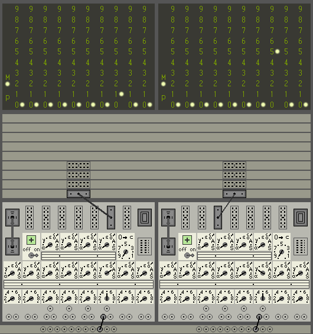

> Descrição da Imagem: Captura de tela de simulador estrutural do ENIAC exibindo a face frontal de dois Acumuladores interconectados durante a execução de uma multiplicação por adições sucessivas (100×5=500). No topo de cada painel, a matriz de lâmpadas neon reflete o estado estático dos contadores de anel decádicos, com o acumulador da esquerda exibindo a lâmpada do dígito 1 acesa na terceira década (ou seja, uma centena) e lâmpadas no zero nas demais posições, retendo o valor 100; o acumulador da direita exibe a lâmpada do dígito 5 acesa nas centenas, retendo o produto acumulado de 500. Na seção intermediária, cabos verticais conectam a saída de transmissão da primeira unidade e a entrada de recepção da segunda unidade à mesma linha horizontal nas bandejas de dados, demonstrando o tráfego de trens de pulso ponto a ponto. Na base dos painéis, observam-se as chaves rotativas de configuração de entrada (α,β,γ,δ,ϵ), controles de operação e cabos coaxiais acoplados às calhas de controle inferiores (Program Trays) para disparar a repetição do ciclo.

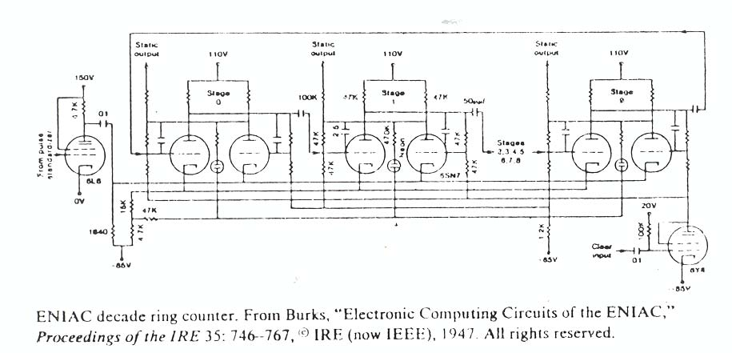

> Descrição da Imagem: Esquema elétrico de um contador de anel decádico do ENIAC. O circuito detalha a interconexão em laço fechado dos estágios de contagem, onde a saída do estágio 9 conecta-se diretamente de volta à entrada do estágio 0 através da linha superior. Cada estágio individual (Stage 0, Stage 1 e Stage 9, com os estágios 2 a 8 omitidos no desenho) é estruturado em torno de uma válvula duplo-tríodo 6SN7 com acoplamento cruzado resistivo e capacitores de aceleração, acompanhada por uma lâmpada neon para sinalização visual do estado ativo. À esquerda, uma válvula de potência 6L6 atua como estágio de entrada, injetando os pulsos de 100 kHz na linha comum que comuta os biestáveis sequencialmente. No topo de cada estágio, destacam-se os terminais de saída estática ("Static output"), responsáveis por fornecer a tensão contínua que representa o operando retido. No canto inferior direito, uma válvula conectada à entrada "Clear input" força o retorno síncrono do anel ao estágio 0 ao receber o pulso de Reset.

### 6.3.4 Signal Transmission
A transformação dos números retidos nos anéis em pulsos móveis dentro das calhas de dados ocorria através da coordenação entre o Acumulador e a Unidade Cíclica. O Acumulador modulava os sinais contínuos gerados pela Unidade Cíclica para organizar e traduzir os números nos anéis em pulsos.

A transmissão operava dentro do Ciclo de Adição padrão de 200 microssegundos, dividido em 20 intervalos de 10 microssegundos. A Unidade Cíclica distribuía permanentemente para toda a máquina dois trens de pulso mestres pela bandeja de sincronização:

- Trem 10P: Uma sequência contínua de dez pulsos elétricos emitidos na primeira metade do ciclo (tempos 1/20 a 10/20).
- Trem 9P: Uma sequência contínua de nove pulsos elétricos emitidos nos tempos 1/20 a 9/20.

Quando um Program Pulse atingia o terminal de controle de um Acumulador, ordenando a emissão do seu valor, a unidade executava uma leitura por rotação completa, onde o Acumulador desviava o trem 10P da Unidade Cíclica diretamente para a linha de entrada comum dos seus anéis decádicos. Esses dez pulsos forçavam os anéis a avançarem exatamente dez passos, fazendo o estado ativado dar uma volta completa pelo anel e retornar ao mesmo número original. Simultaneamente, o trem 9P da Unidade Cíclica era aplicado à entrada de uma válvula pentodo (que operava como uma comporta de saída para a calha de dados). No instante exato em que o anel passava do estágio 9 para o estágio 0 durante a rotação, a tensão de transição acionava essa comporta pentodo, liberando a passagem dos pulsos restantes do trem 9P para o cabo de saída (Digit Trunk).

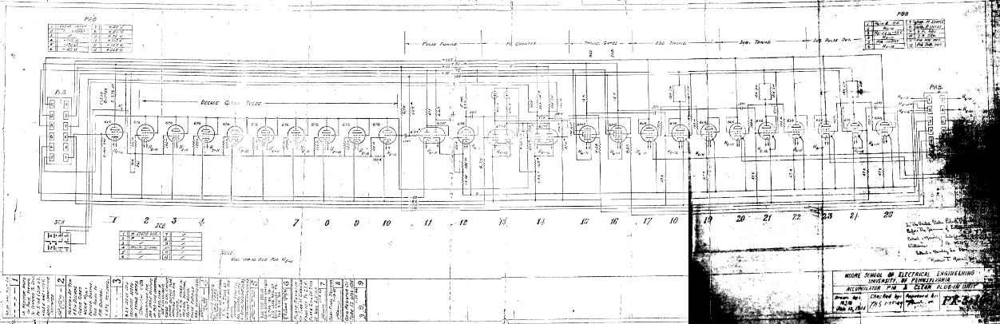

> Descrição da Imagem: Documento técnico original PX-5-108 da Moore School of Electrical Engineering (Universidade da Pensilvânia), intitulado "Accumulator PM & Clear Plug-In Unit". O esquema elétrico detalha o circuito modular plugável responsável por três funções centrais do Acumulador: a indicação de sinal algébrico (PM - Plus/Minus), a seleção de rotas de saída de pulsos (Add/Subtract) e o disparo de limpeza das décadas (Clear). O diagrama divide-se em blocos funcionais sequenciais da esquerda para a direita:
>
> Decade Clear Tubes: O alinhamento de válvulas de potência à esquerda (tubos 2 a 11, identificados individualmente como 6L6) é dedicado a resetar as dez décadas contadoras do acumulador. Quando a unidade opera em Modo de Limpeza (Clear), um pulso recebido pela entrada "Clear Input" dispara essas válvulas em paralelo, injetando uma descarga elétrica síncrona que força os dez anéis decádicos simultaneamente de volta ao estágio 0.
> Pulse Former e PM Counter: Na região central (tubos 12 a 14), localiza-se o circuito formatador de pulsos acoplado ao biestável do contador de sinal (PM Counter). Esse biestável retém o estado do sinal algébrico do resultado intermediário (+ ou -), controlando a polarização das portas lógicas subsequentes.
> Transmission Gates e Transmitters (Add/Sub): Na metade direita (tubos 15 a 25), encontram-se as comportas pentodo de transmissão ("Trans. Gates") e os bancos de amplificadores de saída para adição ("Add Trans.") e subtração ("Sub Trans."). Esse conjunto executa o chaveamento dos trens de pulso da Unidade Cíclica detalhado no tópico 6.3.4, direcionando os pulsos emitidos diretamente para os terminais de saída "Add Pulse Out" ou "Sub Pulse Out".
> Terminais de Conexão (PAB, PBB e SCB): As tabelas de pinagem nas extremidades mapeiam as linhas de alimentação contínua (-400 V, -150 V, +150 V, +225 V) e os pontos de interligação física com as calhas da máquina, incluindo a recepção dos pulsos de controle ("Prog. Input") e a saída de status estático ("PM Static Out").

Por exemplo, para transmitir o dígito 4, o anel iniciava no estágio 4. Os primeiros seis pulsos do trem 10P avançavam o anel até o estágio 0 (5, 6, 7, 8, 9, 0). Nesse momento após o sexto tempo, a comporta pentodo abria. Os quatro pulsos restantes do trem 9P (nos tempos 7, 8, 9 e o complemento de fechamento) passavam livremente pela válvula aberta e entravam no Digit Trunk. Ao término do décimo pulso de 10P, o anel completava os quatro passos finais (1, 2, 3, 4), parando exatamente no estágio 4 onde havia começado.

Ao final do ciclo de 200 microssegundos, a chave de programa determinava o estado final do Acumulador:

- Modo de Retenção: O anel permanecia no estágio original (preservando o número 4 para cálculos futuros).
- Modo de Limpeza (Clear): No tempo 19/20, um pulso de Reset era injetado no anel, forçando o estágio ativo a ir para o estágio 0, apagando o resultado intermediário e liberando a unidade para receber novos dados.


## 6.4 Operand Identification
No ENIAC original, a seleção e a transferência de dados eram realizadas por meio de conexões físicas e controles de programação, diferente dos computadores modernos, que utilizam endereços de memória para localizar informações na RAM.

Os números ficavam armazenados em unidades específicas, como os acumuladores, o Constant Transmitter e as Function Tables. Para a comunicação entre essas unidades, os operadores configuravam cabos, interruptores e controles nos painéis do computador.

### 6.4.1 Como funcionavam as conexões:
O ENIAC utilizava dois sistemas importantes de transmissão:

1. Digit Trays: responsáveis por transportar os pulsos elétricos que representavam os valores numéricos.
2.  Program Trays: responsáveis por transmitir sinais de controle, para coordenar a execução das operações.

Esses sistemas permitiam estabelecer a comunicação entre diferentes unidades do computador.

As conexões eram configuradas antes da execução e podiam ser utilizadas novamente durante o processamento, sem a necessidade de modificar os cabos a cada operação.

### 6.4.2 Exemplo prático:
Considerando que o acumulador A armazene o valor 154 e o acumulador B armazene 47.

Para realizar a soma, os operadores configuravam as conexões e os controles necessários para que o acumulador A transmitisse seu valor ao acumulador B.

Quando a operação era acionada, o acumulador A enviava os pulsos elétricos correspondentes ao número 154. O acumulador B recebia esses pulsos e realizava a soma com o número 47, armazenando o resultado 201.

Dessa forma, a seleção da origem e do destino dos dados era determinada pela configuração das conexões e pelos sinais de controle, sem utilizar endereços de memória RAM.

### 6.4.3 Seleção de valores nas Function Tables:
As Function Tables possuíam um mecanismo específico para selecionar valores numéricos configurados anteriormente.

Cada tabela apresentava 104 linhas, numeradas de -2 até 101, e a seleção de uma linha era realizada a partir de um argumento numérico fornecido por um acumulador.

Por exemplo, caso o argumento fosse 5, o ENIAC poderia selecionar a linha 5 e transmitir os valores previamente configurados nela.
Esse mecanismo permitia acessar diferentes valores durante o processamento, mas não representava um sistema geral de endereçamento de memória RAM.

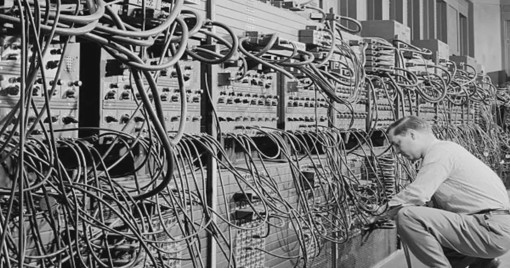

## 6.5 Lack of Modern Addressing
Nos computadores modernos, a memória RAM é organizada em posições identificadas por endereços numéricos. Esses endereços permitem o processador de localizar, recuperar e modificar informações armazenadas.

No ENIAC, não existia uma memória RAM centralizada organizada dessa maneira. Os dados eram armazenados em unidades específicas, e sua transferência dependia de conexões físicas e controles de programação.

### 6.5.1 Endereços de memória:
Um endereço de memória identifica uma posição na qual determinada informação está armazenada.

Por exemplo, em um computador moderno, o endereço 0x1000 poderia identificar uma posição que contém o valor 125.

No ENIAC original, entretanto, o acesso a um valor armazenado em um acumulador não era realizado por meio de um endereço geral de RAM, mas pela seleção e ativação da unidade correspondente.

### 6.5.2 Ponteiros:
Na programação moderna, um ponteiro é um valor que representa um endereço de memória, permitindo acessar indiretamente uma informação armazenada.

No ENIAC, esse conceito não era aplicado igualmente, pois o computador não possuía uma memória RAM geral endereçável, na qual os endereços pudessem ser utilizados para acessar diferentes posições de armazenamento.

Embora as tabelas de funções permitissem selecionar valores por argumentos numéricos, esse mecanismo não era equivalente ao uso de ponteiros em uma memória RAM moderna.

### 6.5.3 Modificações em 1948:
É válido destacar que o ENIAC passou por modificações em 1948, permitindo a execução de programas codificados e armazenados nas tabelas de funções.

Com essa mudança, o computador passou a utilizar mecanismos de endereçamento das tabelas para recuperar instruções e valores previamente configurados.

Mesmo assim, após essas modificações, o ENIAC não possuía uma memória RAM convencional como a utilizada nos computadores modernos.

Logo, a ausência de endereçamento geral de RAM e de ponteiros convencionais caracteriza principalmente a arquitetura original do ENIAC, baseada em conexões físicas e controles distribuídos.


## 6.6 Switch-Based Data Selection
- Uso de chaves seletoras para indicar a um acumulador quais dados internos enviar para a saída

Cada acumulador Do Eniac tinha 12 controles de programa, e cada um tinha uma chave de operação de 9 posições. Essa chave decidia se o acumulador receberia dados (por qual dos 5 canais de entrada) ou transmitiria o número guardado, o seu complemento, ou os dois. Outras chaves definiam quantas vezes transmitir e se limpar depois. Essa junção simples de ações, quando combinadas geravam a complexidade assustadora do Eniac.

### 6.6.1 Separação e divisão das chaves seletoras

Quanto as chaves em si, cada posição direcionava o acumulador a uma ação diferente, sendo que as posições se dividiam em:

α (Alfa), β (Beta), γ (Gama), δ (Delta), ε (Épsilon) Recebiam o número que chega pelo canal de entrada correspondente
> Essas serviam apenas como direcionadoras de dados, representando uma espécie de ponte para que as operações pudessem ser reorganizadas e alinhadas. Um fato curioso é que de certa forma, é possível compreender estas como "Váriaveis" visto que são cabeamentos tratados como icógnitas que apenas representam valor verdadeiro após algum outro valor ter sido atrelado a este anteriormente.

A	Transmitir o número armazenado (saída “add”)
> Nesse caso o número armazenado era repassado com o comando ADD, gerando uma soma com seja lá qual outro número era complementado.

S	Transmitir o complemento do número (saída “subtract”)
> Mesma situação do coamndo ADD mas nesse caso sendo o SUBTRACT, logo, subtraindo o valor do conjunto de dados.

AS	Transmitir os dois ao mesmo tempo
> Usado em operações mais complexas para trnasmitir um mesmo valor como soma e subtração sem necessitar do uso de dois acumuladores. Economizando linhas de transferência de dados.

O	Não receber nem transmitir (útil para limpar ou atrasar um pulso)
> Uso mais situacional e dependente da necessidade de sincronização ou "descarte" de dados. Também utilizado quando não havia dado correlacionado necessário.

### 6.6.2 Funcinamento das chaves seletoras

A chave não movia dados diretamente, mas sim escolhia qual circuito seria ativado quando um pulso de programa chegasse ao controle. O flip-flop do controle estimulado enviava um sinal por uma seção da chave aos circuitos de recepção ou de transmissão. Na transmissão, abria as portas que deixavam os pulsos de dígitos chegarem às saídas A e/ou S.
Já para a saída do dado interno, na transmissão, os pulsos 10P eram enviados a todas as décadas do acumulador ao mesmo tempo, e cada pulso avançava o contador de anel um estágio para um dígito d armazenado.
Primeiro saíam 9−"d" pulsos de uma outra linha (9P) pela saída S, que representam o complemento do dígito.
O pulso que levava o contador de 9 para 0 acionava o flip-flop da década, que fechava a saída S e abria a A.
Depois saíam "d" pulsos pela saída A, que representam o próprio dígito.

> Nesse caso, "d" representa o valor variavél que era trago pela linha 9P

Ao fim dos 10 pulsos, o contador voltava ao dígito original. Ou seja, transmitir não apagava o número, a menos que a chave de limpeza (O) mandasse. Já o sinal seguia uma regra parecida. Para um número positivo, 9 pulsos saíam pelo fio de sinal da saída S. Para um negativo, saíam pelo da saída A. Essa diferença era usada para decisões de desvio, enviando o sinal a um “programa fantasma” onde posteriormente poderia ser resgatado.

### 6.6.3 Chaves extras

Haviam outras chaves extras que completavam a seleção, sendo elas:

Chave de limpeza e correção (C ou O), sendo que em transmissão, o C faz o acumulador se limpar depois de enviar. Em recepção, C faz com que ele capture o pulso 1'P (usado para completar o complemento de 10).
> Como já citado, a chave "O" servia como negativo, então apenas cortava e limpava o pulso como um todo sem maiores rodeios.

Chave de repetição (1 a 9), nessas o acumulador executa a operação "r" vezes seguidas, uma por tempo de adição. A limpeza ocorre uma única vez, no fim da última repetição, e o pulso de saída é emitido depois de "r" tempos.
> Sendo logicamente, "r" o número selecionado na chave.

Chave de algarismos significativos (0 a 10), essa chave em especial é comum ao acumulador inteiro, definindo em que casa o pulso 1'P entra quando se transmite o complemento e em que década fica o “5” ao limpar.
>  Isso representava a forma de arredondar contas com valores quebrados, caso fosse necessário.

Chave de limpeza seletiva (SC ou O), essa aqui definia quais acumuladores limpam quando a unidade iniciadora manda um sinal geral.
> Novamente citando que (O) era uma limpeza geral do acumulador, enquanto SC limpava de forma mais ordenada seguindo  o sinal geral.

### 6.6.4 Exemplo didático

Um exemplo mais prático e visual seria:

Para somar o acumulador 3 (valor 15) ao acumulador 4 (valor 27), os dois recebem o mesmo pulso de programa. O 3 está com a chave em A e transmite 1 pulso na casa das dezenas e 5 nas unidades. O 4 está em α (Alfa) e recebe, resultando em 42. Para formar a + r·b, o primeiro acumulador recebe com repetição r e o segundo transmite com repetição maior ou igual a r.
> Sendo nesse caso aqui, 3 e 4 numerações genéricas de acumuladores anteriores, podendo ser substituido por X,Y A,B ou etc. no caso da formula a + r·b, "a" é o acumulador 3, "r" é o número na chave de repetições (quantas vezes quer repetir aquela ação), e "b" o acumulador 4.

## 6.7 Access Bottlenecks
O ENIAC possuía limitações físicas no encaminhamento de dados entre painéis distantes, pois a comunicação entre suas unidades dependia de conexões elétricas estabelecidas por cabos e bandejas de transmissão. Como os acumuladores, multiplicadores, e outras unidades ocupavam diferentes painéis físicos, era necessário estabelecer caminhos específicos para que os pulsos elétricos de uma unidade chegassem até a outra unidade.
A transferência dos valores numéricos ocorria por meio dos Digit Trays (que transportavam os pulsos correspondentes aos algarismos) e, para conectar duas unidades, os operadores precisavam ligar a saída da unidade transmissora à entrada da unidade receptora, utilizando os pontos de conexão disponíveis. Assim, a distância física entre os painéis influenciava a organização do cabeamento e a complexidade da montagem do sistema.

### 6.7.1 Dificuldades no encaminhamento dos dados
Uma das principais limitações era a necessidade de organizar fisicamente as conexões entre as unidades. Quando uma operação exigia que o resultado de um cálculo fosse enviado a um painel distante, era necessário garantir que os cabos estivessem conectados aos terminais corretos e que os controles de programa estivessem configurados para autorizar a transmissão e a recepção dos dados e, por isso, a grande quantidade de cabos e conexões dificultava a identificação de falhas. 
Além disso, uma ligação incorreta, um mau contato ou uma configuração inadequada poderia impedir que os pulsos chegassem ao destino esperado, exigindo verificações nos painéis e no cabeamento.
Ademais, sua estrutura física limitava a flexibilidade do encaminhamento porque o ENIAC dependia de rotas previamente estabelecidas e, para modificar o caminho dos dados, os operadores precisavam alterar as conexões e os controles envolvidos.

### 6.7.2 Impacto na execução dos cálculos
Em cálculos que envolviam várias unidades, era necessário definir antecipadamente como os valores seriam transferidos de um painel para outro, garantindo que cada resultado chegasse à unidade responsável pela próxima operação.
Embora os pulsos elétricos percorressem os cabos rapidamente, a complexidade estava principalmente na organização física das ligações, na manutenção dos contatos e na necessidade de sincronizar as unidades transmissoras e receptoras. Portanto, a distância entre os painéis não representava um grande atraso elétrico por si só, mas aumentava as exigências de cabeamento, organização e manutenção.
Dessa forma, os gargalos de acesso do ENIAC estavam associados à dependência de conexões físicas específicas para encaminhar informações entre unidades distantes. Essa característica tornava alterações na estrutura de processamento mais trabalhosas.

