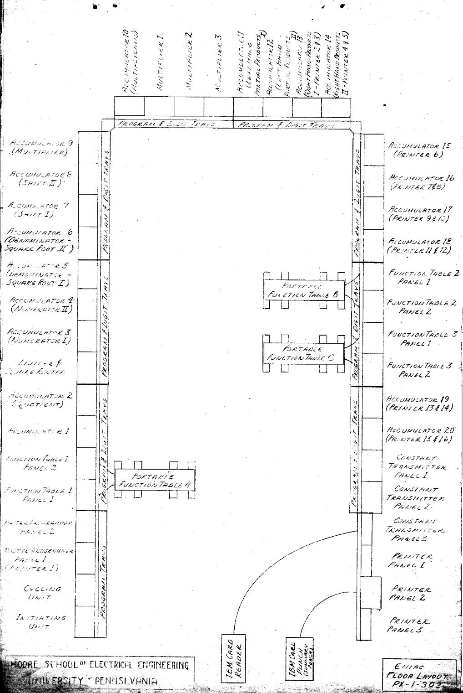
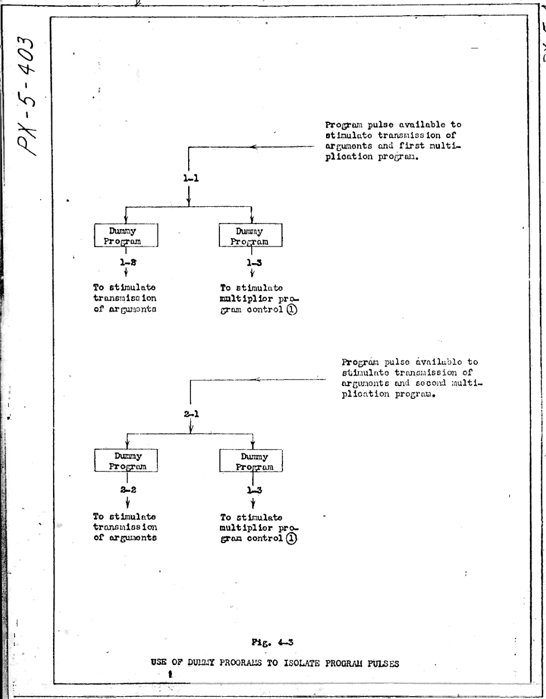
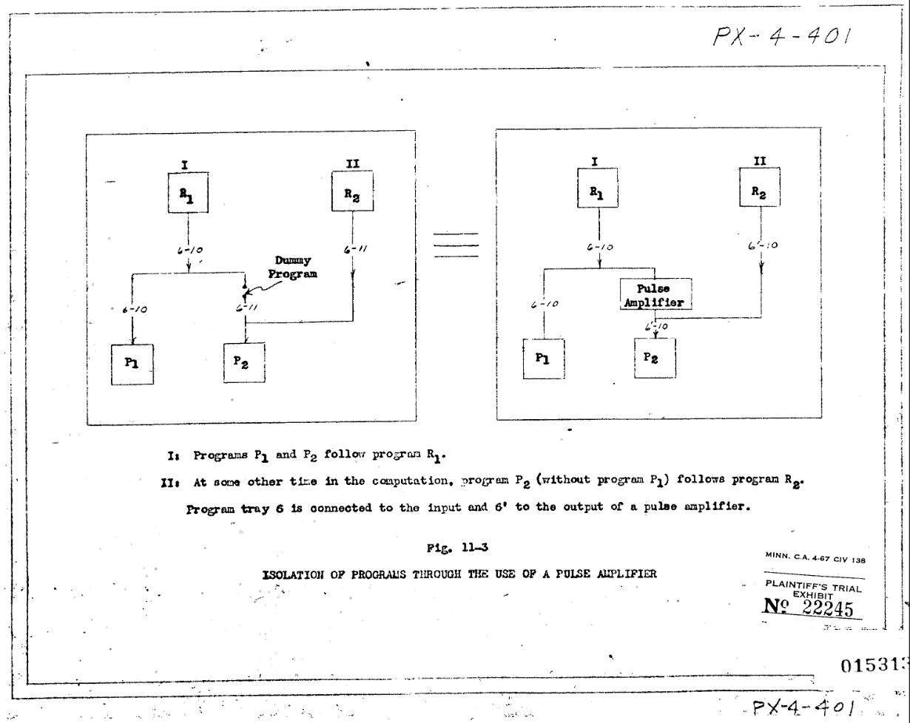
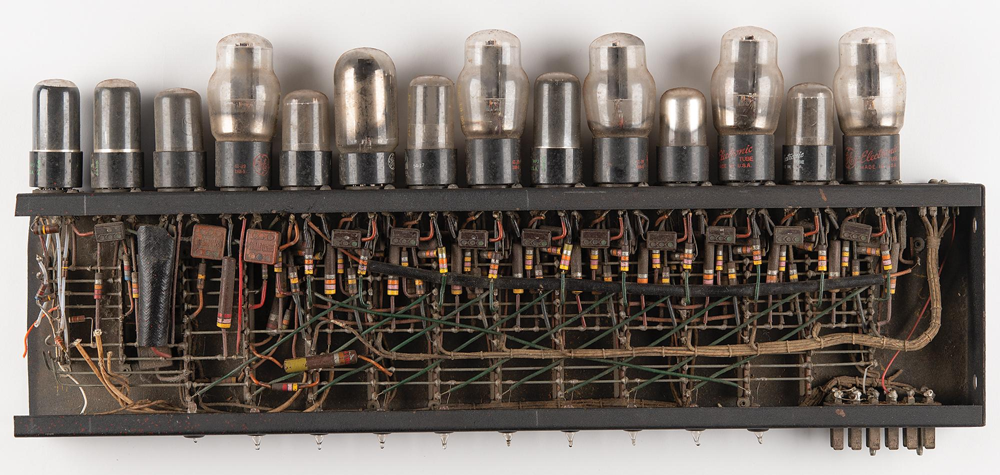
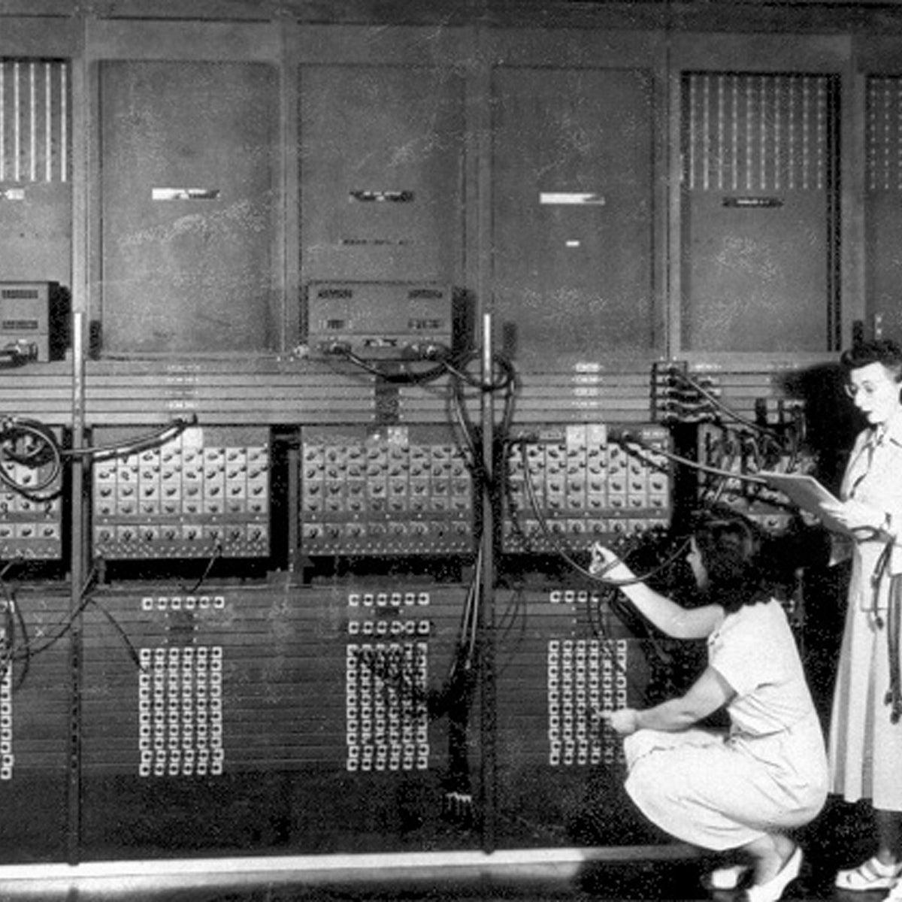

# 7. Processing Units

## 7.1 Decentralized Processing

O poder computacional do ENIAC era descentralizado e distribuído ao longo de suas 40 unidades funcionais, delegando a execução das equações para módulos matemáticos especializados compostos por 20 Acumuladores para adições e subtrações, 1 Multiplicador de Alta Velocidade e 1 Divisor e Extrator de Raiz Quadrada. Cada módulo continha a infraestrutura de válvulas necessária para realizar a aritmética do início ao fim.

O processamento era gerido por pulsos de programa que, ao chegar numa porta de controle, ativavam a unidade para executar a operação configurada em suas chaves rotativas e emitir um pulso de saída para engatilhar a próxima etapa na malha de cabos. O transporte dos operandos numéricos entre essas unidades independentes ocorria pelas calhas frontais de dígitos, exigindo que a equipe conectasse cabos físicos interligando a saída de dados da unidade transmissora diretamente à entrada da unidade receptora. A configuração do cabeamento externo da máquina era o algorítimo programável responsável por definir as equações a serem realizadas, e as unidades de processamento eram como funções assíncronas que podiam ser chamadas durante a execução do algorítimo.

A descentralização agregava o armazenamento temporário e a lógica aritmética no mesmo circuito, eliminando a necessidade de transferir dados para um núcleo de cálculo central. A adição ocorria diretamente dentro dos contadores de anel do painel, que já guardavam o valor base e serviam de interface para visualizar o estado das operações (3 em 1!). Para gerenciar essa autonomia, cada unidade abrigava múltiplos circuitos locais de controle independentes, permitindo que um único Acumulador executasse até 12 comportamentos diferentes ao longo da execução do algoritmo dependendo exclusivamente de qual soquete frontal recebesse o pulso de programa.

> Descrição da Imagem: Filmagem histórica dos contadores de anéis mostrando os resultados dos calculos ocorrendo durante a operação do ENIAC.

O componente estrutural responsável por unificar o sistema era a Unidade Cíclica, que funcionava como o clock do computador ao distribuir os trens de pulso contínuos que coordenavam o tempo de execução de todas as unidades matemáticas (diferente de computadores modernos o clock era completamente fixo, e tentar dar um overclock (diminuindo as janelas de tempo dos ciclos e dos pulsos dentro dos ciclos) na máquina pravavelmente iria: 1. Apenas desincronizar tudo pois o hardware das unidades não conseguiria acompanhar o rítmo dos pulsos, ou 2. A sala inteira iria explodir). 

A distribuição física das tarefas em múltiplos módulos viabilizava a execução de operações em paralelo. A desvantagem dessa arquitetura era que uma grande proporção de painéis e válvulas permanecia inutilizada durante etapas de cálculo que não exigiam suas funções matemáticas específicas. Mas, em contrapartida, essa arquitetura distribuída e a constante presença de unidades ociosas forneciam uma redundância necessária para a manutenção do sistema (que possuia multiplos pontos de falha). A queima de uma válvula em um painel específico não paralisava a máquina de forma irreversível, permitindo que a equipe de engenharia isolasse o módulo defeituoso e retomasse o processamento redirecionando os cabos de dados e controle daquela etapa matemática para qualquer outro Acumulador livre na sala.

## 7.2 Parallelism
Como a arquitetura possuía dezenas de unidades matemáticas autônomas, a execução paralela no ENIAC ocorria pela ramificação dos cabos de controle, por exemplo: a equipe configurava o sistema para que um único pulso de programa ativasse múltiplos painéis no exato mesmo momento. Ao plugar o cabo de saída de uma operação concluída em conectores (1 - 1 unidades) ou utilizar amplificadores de pulso (tópico 3.2.6) para dividir o sinal (1 - n unidades), o pulso elétrico viajava simultaneamente para as portas de entrada de diferentes Acumuladores endereçados pela organização dos cabos.

O funcionamento simultâneo dessas unidades dependia da sincronização de ciclos gerenciada pela Unidade Cíclica. Como todas as unidades compartilhavam o mesmo ciclo básico de adição de 200 microssegundos, operações paralelas de mesma complexidade mantinham-se perfeitamente alinhadas no tempo. Se três Acumuladores recebessem um pulso de ativação simultâneo, os três iniciariam a leitura de seus operandos, executariam a soma e emitiriam seus pulsos de conclusão no exato mesmo instante, preservando a integridade cronológica da equação.

A execução paralela de operações com quantidades de ciclos diferentes exigia mecanismos de ressincronização. Uma adição consumia apenas 1 ciclo (200 microssegundos), enquanto uma multiplicação consumia cerca de 14 ciclos e uma divisão podia ultrapassar 140 ciclos. Se uma ramificação do algoritmo calculasse uma soma em paralelo com uma divisão, a ramificação mais rápida precisava aguardar o término da mais lenta antes que os resultados pudessem ser combinados. Exemplo: quanto dá (10 + 1) + a raiz quadrada de (500000 + 498001)? As duas adições seriam feitas em 1 ciclo, mas o resultado da primeira (11) teria que esperar 139 ciclos até a raiz quadrada de 998001 ser encontrada (999) e adição final ser feita para encontrar o resultado (1010) em 141 ciclos. O gargalo era enorme quando analisamos que: No espaço de 140 ciclos, cada acumulador podia fazer 140 adições. Haviam 20 acumuladores, ou seja, o tempo para encontrar uma raiz quadrada era igual ao tempo para encontrar o resultado de 2820 adições. (Devemos entrar em mais detalhes sobre isso no arquivo 09-performance, tópico 9.2 Computational Speed)

Para alinhar os ciclos de operações desincronizadas, a equipe utilizava programas fictícios (Dummy Programs). Um Acumulador ocioso recebia o pulso de conclusão da operação rápida e era configurado para não realizar nenhuma aritmética, atuando apenas como um temporizador de espera. Ele consumia a quantidade exata de ciclos em branco necessária até que a operação matemática longa fosse finalizada. O avanço para a próxima etapa unificada da equação só ocorria quando as trilhas paralelas terminavam e seus respectivos sinais se realinhavam temporalmente.

> Descrição da Imagem: Um diagrama sobre o uso de controles de programa fictícios (Dummy Programs) para realizar a ramificação paralela e o isolamento elétrico de pulsos de controle durante rotinas de multiplicação. Na sequência superior, um pulso de programa inicial entra pelo nó 1-1 e divide-se em duas vias simultâneas: a via esquerda passa por um Dummy Program para disparar a transmissão dos argumentos numéricos (saída 1-2), enquanto a via direita passa por outro Dummy Program para acionar o controle do multiplicador (saída 1-3). Na sequência inferior, um segundo pulso entra pelo nó 2-1 e repete a bifurcação para uma nova operação, ativando novos argumentos (saída 2-2) e convergindo para a mesma entrada do multiplicador (saída 1-3). A intercalação dos módulos Dummy atua como um isolador unidirecional, impedindo o refluxo de corrente elétrica entre os circuitos e garantindo que o sinal ramificado dispare as unidades paralelas sem provocar ativações falsas nas linhas interligadas.

> Descrição da Imagem: O esquema ilustra o emprego de um programa fictício (Dummy Program, à esquerda) e a utilização de um amplificador dedicado (Pulse Amplifier, à direita). A rotina I exige que o término da operação R1 dispare simultaneamente os programas paralelos P1 e P2 (através da linha de bandeja 6-10), enquanto a rotina II exige que, em outra etapa da equação, a operação R2 ative apenas P2 (via linha 6-11), sem acionar P1. A intercalação do Dummy Program ou do Pulse Amplifier (posicionado entre as bandejas 6 e 6') estabelece uma barreira de retenção unidirecional. Esse isolamento impede que o sinal elétrico injetado por R2 sofra refluxo pelas conexões compartilhadas e dispare acidentalmente a unidade P1, assegurando a integridade lógica das ramificações paralelas.

O paralelismo não se limitava à execução simultânea de múltiplas equações em painéis distintos, operando também em nível interno durante a aritmética básica. A transferência e a soma dos operandos ocorriam de forma paralela em todas as casas decimais de uma palavra matemática. Ao somar dois valores de dez dígitos, a máquina não processava as unidades, depois as dezenas e depois as centenas sequencialmente. Os trens de pulso correspondentes a todas as dez casas decimais viajavam pelas 10 primeiras das 11 vias paralelas de um Digit Trunk e atingiam os contadores de anel do Acumulador receptor no exato mesmo microssegundo, garantindo que o ciclo de adição levasse os mesmos 200 microssegundos independentemente da magnitude dos números envolvidos.

> Descrição da Imagem: Gif de parte da face frontal de dois Acumuladores e da Unidade Cíclica executando a adição de 500000 com 498001. No quadrante superior esquerdo, o osciloscópio da Unidade Cíclica mapeia os trens de pulso padronizados (CPP, 10P, 9P, 1P a 4P, CCG e RP), com um cursor vertical destacando a passagem do tempo ao longo do ciclo de 200 microssegundos. No topo do painel no centro, o acumulador transmissor (armazenando 500000) recebe o trem 10P e gira todos os dez anéis decádicos por uma volta completa de 10 passos para realizar a leitura não-destrutiva. No topo do painel direito, o acumulador receptor (inicialmente retendo 498.001) recebe os sinais transmitidos por 1 tronco de digitos, com as décadas que receberam zero pulsos permanecendo estáticas, enquanto a sexta década (centenas de milhar) recebe 5 pulsos (Gerados pelo gerador 4P + 1'P), avançando do estágio 4 para o estágio 9 e setando o resultado 998001. Na seção inferior, cabos de manobra interligam os dois painéis através da mesma calha de dados horizontal, demonstrando o fluxo síncrono de operandos entre as 2 unidades. Todo o processo de adição é feito dentro de 1 ciclo.

A principal limitação estrutural para a escala do paralelismo global era a disponibilidade de rotas de comunicação isoladas. A execução simultânea de múltiplas operações exigia que cada par de unidades transmissora e receptora utilizasse um caminho de dados exclusivo nas bandejas frontais. Se duas operações paralelas independentes tentassem transmitir seus resultados através da mesma calha de dígitos (Digit Trunk) durante o mesmo ciclo temporal, os pulsos elétricos colidiriam fisicamente no condutor de cobre, fundindo os sinais e corrompendo os operandos. A equipe precisava mapear rotas de cabos estritamente independentes para cada ramificação paralela da equação, o que frequentemente esgotava as vias de comunicação disponíveis na máquina antes mesmo de esgotar o hardware de processamento.

## 7.3 Accumulators
- Como estes performavam adições e subtrações usando trens de pulso

A ideia central é que o ENIAC representava números por quantidade de pulsos que ficava armazenado temporiariamente em um flip-flop. Um dígito "X" era o equivalente a "X" pulsos em um fio, e um número de 10 dígitos mais o sinal viajava em 11 fios ao mesmo tempo, um por casa decimal e um para o sinal, essa junção de fios eram as chamadas trays (bandejas).

### 7.3.1 Agrupamento de pulsos e dígitos

Cada casa decimal do numéro correspondia a um anel de 10 flip-flops. O dígito era indicado pelo único flip-flop em estado diferente dos outros nove. Logo se o terceiro flip-flop estava acionado e o resto desligado, o número daquela casa decimal seria o 3. Havia ainda um contador binário (PM) para o sinal, separando assim número positivos ou negativos.
Cada pulso recebido avançava o anel uma posição, como a roda de uma calculadora mecânica. Um anel em 5 que recebe 3 pulsos avança e para em 8. Se o anel passa de 9 para 0, gera um pulso de “vai-um” para a casa vizinha. Assim aumentando a contagem do próximo acumulador.
> Importante dizer que negativos eram guardados como complemento de 10¹⁰ com sinal M, o que evitava fazer o contador girar ao contrário.

### 7.3.2 Origem dos pulsos e trens de pulso

Como já mencionado, os acumuladores não geravam os pulsos. Na realidade apenas abriam portas para deixar passar pulsos novos provenientes da Unidade de ciclagem, visto que os pulsos se enfraqueciam ao percorrer a máquina.Nesse caso a Unidade de ciclagem emitia vários trens de pulso a cada tempo de adição, que correspondiam a 20 pulsos, ou 200 µs. O que equivale a 5.000 vezes por segundo. 
Os trens relevantes para soma e subtração são:

CPP (pulso de programa central)	Dispara a próxima operação programada.
> Usado de forma ampla por todo o sitema, destrava as próximas portas para que os pulsos seguissem.

10P (10 pulsos)	Gira os anéis na transmissão. Uma volta completa devolve o número ao valor original.
> Pulso simples, apenas adiciona um valor ao anel de flip-flops.

9P (9 pulsos)	Vira os pulsos de dígito que saem pelas saídas A e S.
> Reinicia os flip-flops e abre as saídas para rediricionar os pulsos quando uma soma de 10 digítos era alcançada.

1'P (pulso de complemento)	Completa o complemento de 10.
> Trabalhando em conjunto com o 9P, esse pulso serve como "saída" final, indicando a nova dezena, centena ou etc do próximo anel de flip-flops.

Carry-clear (pulso longo de 70 µs)	Mantém abertas as portas de vai-um.
> O pulso responsável por permetir a passagem do pulso Vai-um

Reset	Rearma os flip-flops de vai-um.
> Usado para reprogramar caso fosse necessário usar o vai-um (quase sempre)

### 7.3.3 Transmissão

Os 10P entravam em todas as casas ao mesmo tempo. Se a casa guarda o dígito "X", os primeiros 9−X dos 9P saem pela saída S (complemento). O pulso que leva o anel de 9 para 0 aciona o flip-flop da casa, que fecha S e abre A, e os "X" pulsos seguintes saem por A, assim garantindo que cada unidade, dezena e assim por diante estivesse em seu devido lugar. Ao fim, o anel volta ao dígito original, então transmitir não apagava o número, a menos que a chave de limpeza mandasse.

### 7.3.4 Receber e propagar o vai-um

O acumulador receptor abria as portas de um dos 5 canais de entrada, e cada pulso recebido avançava o anel. Se uma casa chegava ao 9 e recebia mais um pulso, o flip-flop da casa “lembrava” o vai-um. Esse vai-um era liberado depois, pelo pulso de reset. Quando o vai-um caía numa casa que já estava em 9, usava-se o carry-clear para propagar em cascata. No pior caso, se considerar 1 + 9.999.999.999, o vai-um deveria passar por todos os estágios dos flip-flops de todos os aneis, sabendo que a propagação levava até 25 µs foi criada uma janela de 70 µs para que o vai-um pudesse contabilizar tudo.

### 7.3.5 Subtração

Subtrair era somar o complemento. A saída S enviava o complemento de 9 de cada dígito, mais o pulso 1'P na casa certa para virar complemento de 10. O sinal era invertido (P envia 9 pulsos pelo fio de sinal, M envia nenhum). Por último o vai-um da 10ª casa entrava no contador de sinal, o que dava o sinal correto no resultado.

### 7.3.6 Exemplos

#### 7.3.6.1 Soma: 
O acumulador 1 guarda 15 e o 2 guarda 27. O 1 transmite 1 pulso na casa das dezenas e 5 nas unidades. No 2, as dezenas vão de 2 para 3, as unidades vão de 7 para 2 com vai-um contabilizado, e as dezenas chegam a 4, resultando em 42.

#### 7.3.6.2 Subtração 
27 − 15. A saída S do 15 envia 8 pulsos nas dezenas (9−1) e 4 nas unidades (9−5), mais o 1'P, o que dá 85, o complemento de 15 em 100. Somando, 27 + 85 = 112. O vai-um que sai da casa mais alta inverte o sinal e deixa +12.

> Somar, subtrair e transmitir levavam um tempo de adição, ou seja, 200 µs.

> Cada acumulador tinha cerca de 550 válvulas, o que dá cerca de 11.000 só nos 20 acumuladores.

## 7.4 High-Speed Multiplier

 A unidade dedicada a operações de multiplicação por uma tebela foi idealizada pelos projetistas na necessidade de otimizar os calculos. Inicialmente cogitaram multiplicar por somas repetidas. No entanto, mesmo sendo rápido eletronicamente, acabaram optando por uma consulta a uma tabela. Visto que assim poupariam processamento e memória. Como só havia um multiplicador na máquina, era de suma necessidade que este fosse o mais rápido possível, visto que multiplicações apareciam com frequência semelhante à das somas.

### 7.4.1 Funcionamento

A tabuada era uma matriz de resistores. Ao receber dois dígitos decimais, ela devolvia dois pulsos que representavam o produto, sempre com dois dígitos, como por exemplo 2 × 3 = 06.
A casa das unidades era enviada para um acumulador, enquanto as dezenas eram enviadas a outro, formando dois produtos parciais. Ao fim, eles eram somados. Isso foi inspirado no método usado pelo multiplicador eletromecânico da IBM 601. 
Os dígitos do multiplicador chegavam de forma estática até os “seletores do multiplicador”, que eram uma matriz 10 × 10 de válvulas ligada por cabos aos contadores do acumulador, a válvula da linha "X" e coluna "Y" acendia quando a casa "Y" guardava o dígito "X", assim concretizando o resultado da multiplicação. Ligar isso levava cerca de um tempo de adição, ou 200 µs.

### 7.4.2 Exemplo: 
23 × 4. Pela tabuada, 3 × 4 = 12, nesse caso seriam repassados os dados de unidade 2, dezena 1. Já em 2 × 4 = 08 geraria unidade 8, dezena 0. O parcial das unidades fica 82 com 2 na casa das unidades e 8 na das dezenas. O parcial das dezenas fica 10, sendo 1 na casa das dezenas e 0 na das centenas. Somando ambos se tem o resultado. 82 + 10 = 92.

### 7.4.3 Tempo de operação

Cada dígito do multiplicador levava um tempo de adição, os famosos 200 µs. A conta total era "X" + 4 tempos de adição, onde "X" é o número de dígitos do multiplicador. Num exemplo rápido, 7 dígitos dão 11 e 10 dígitos dão 14. Já para dois números de 10 dígitos, isso é 14 tempos, ou 2,8 ms, oque gera cerca de 357 multiplicações por segundo.
O produto tinha até 20 dígitos, e o operador escolhia 10, sendo os mais significativos e com arredondamento, já o multiplicador e multiplicando eram preservados.Era possível usar o multiplicador enquanto acumuladores somavam e o divisor calculava, desde que as bandejas de dígitos fossem separadas.

## 7.5 Divider & Square-Rooter
- Unidade dedicada à aritimética mais complexa

## 7.6 Internal Components
- Sobre os tubos à vácuo e relés necessários para o funcionamento de cada undiade

## 7.7 Cycling Unit
- Equivalente ao clock do sistema

## 7.8 Master Programmer
- Unidade de controle para loops, ramificações e sub-rotinas

## 7.9 Mathematical Precision

### 7.9.1 Representação dos números decimais:

O ENIAC utilizava o sistema decimal, diferentemente dos computadores modernos, que utilizam predominantemente o sistema binário.

Cada um dos 20 acumuladores podia armazenar um número de 10 dígitos decimais, acompanhado de um sinal positivo ou negativo.

Por exemplo:

(+) 0 0 0 0 0 5 8 9 2 5 = 58.925

(-) 0 0 0 0 0 0 3 8 9 4 = -3.894

Assim, o maior número positivo que um acumulador podia representar era +9.999.999.999, enquanto o menor era -9.999.999.999.

### 7.9.2 Precisão decimal e suas limitações:

O ENIAC utilizava aritmética decimal de ponto fixo. Isso significa que a posição da vírgula não era armazenada automaticamente, sendo determinada pela organização do cálculo.

Por exemplo, os dígitos 0000012345 poderiam representar:
12345;
1234,5;
123,45;
12,345;
E outras opções, dependendo da posição estabelecida para a vírgula.

A principal limitação era a capacidade de 10 dígitos por acumulador. Se uma operação produzisse um resultado maior, seria necessário utilizar técnicas adicionais para representá-lo corretamente.

Portanto, a precisão dependia tanto da capacidade dos acumuladores quanto da escala e dos métodos matemáticos utilizados.

## 7.10 Processing Cycle
### 7.10.1 Como funcionava o ciclo de processamento:

O ENIAC utilizava pulsos elétricos para sincronizar e executar suas operações. A unidade responsável pela sincronização era chamada de Cycling Unit.

Ela operava com uma frequência principal de 100.000 ciclos por segundo (100 kHz), enquanto uma operação básica de adição podia ser realizada em aproximadamente 200 microssegundos, permitindo até 5.000 adições por segundo.

Diferentemente dos computadores modernos, o ENIAC original não buscava instruções em uma memória convencional. As operações eram determinadas por conexões físicas e controles previamente configurados.

### 7.10.2 Como um pulso iniciava uma sequência de operações:

O processamento ocorria da seguinte maneira:
1. Os operadores configuravam os cabos e interruptores necessários para o cálculo.
2. Um pulso de programação iniciava a primeira operação.
3. A unidade recebia o pulso e executava a operação configurada.
4. Ao terminar, enviava um pulso de conclusão para acionar a próxima unidade.
5. O processo continuava automaticamente até finalizar a sequência.
Dessa forma, um único pulso inicial podia desencadear diversas operações consecutivas, sem necessidade de intervenção humana durante cada etapa.

### 7.10.3 Exemplo prático:

Suponha que o ENIAC precisasse calcular:

(132 + 29) × 2 = 322

Primeiro, um pulso de programação iniciava a soma entre os acumuladores, produzindo 161.

Ao finalizar, um pulso de conclusão acionava a etapa seguinte, na qual a unidade multiplicadora realizava 161 × 2.

O resultado 322 era então armazenado no acumulador destinado a recebê-lo.

Esse mecanismo permitia ao ENIAC executar sequências de cálculos automaticamente, utilizando os pulsos de programação para coordenar as operações e a Cycling Unit para sincronizar os circuitos.

