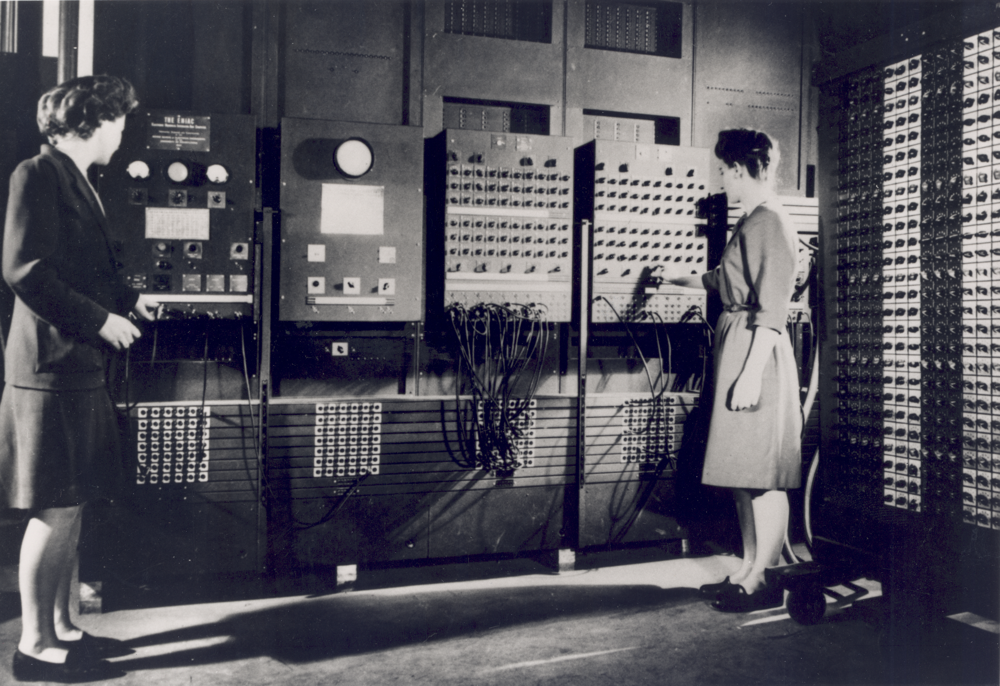
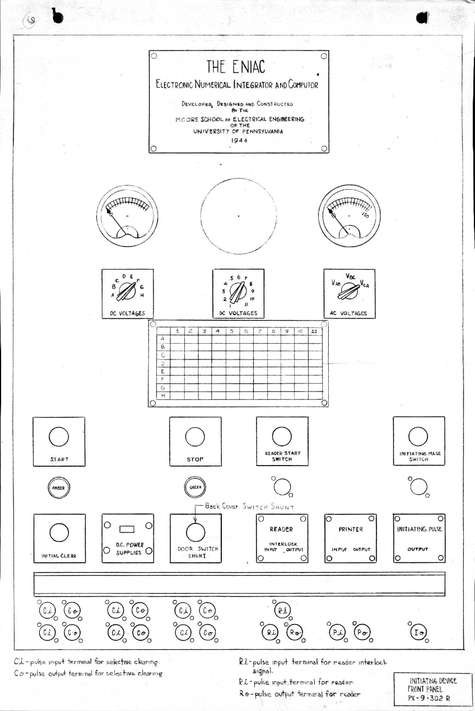
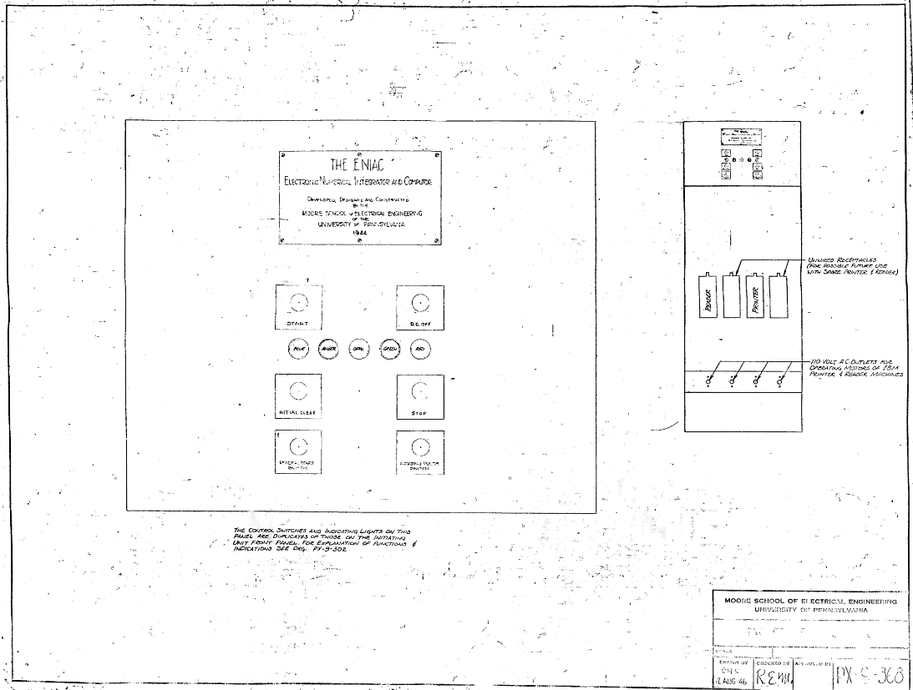
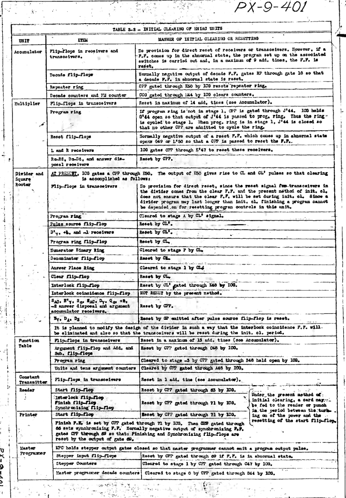
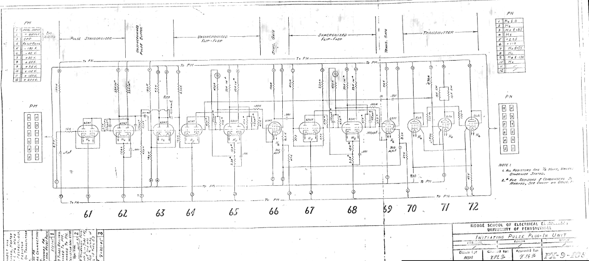
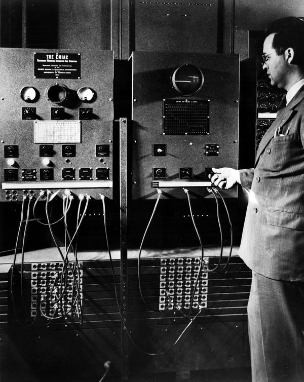
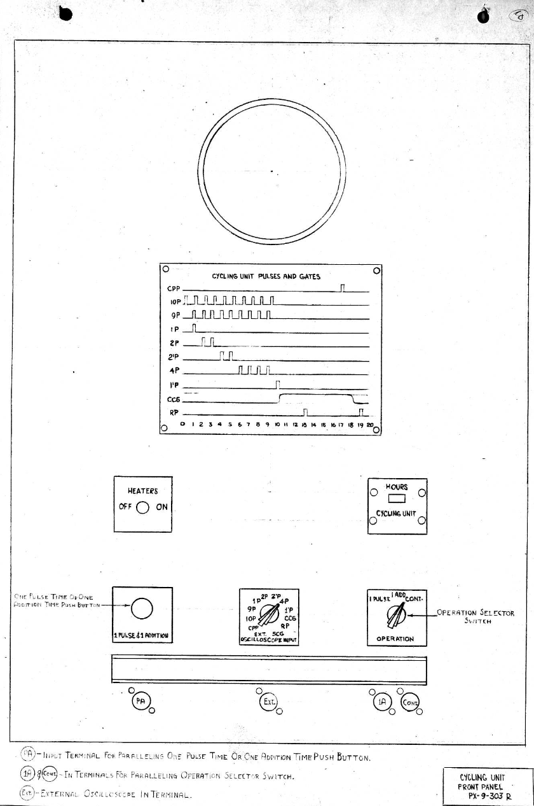
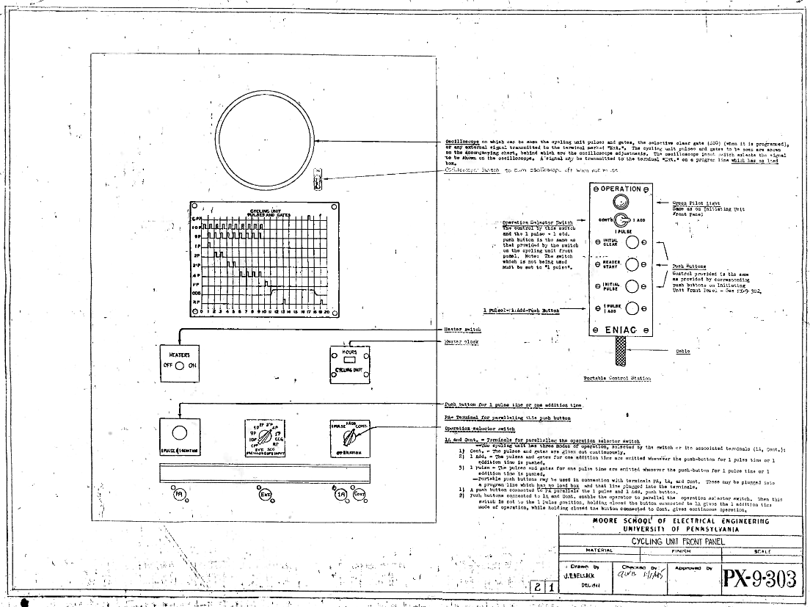
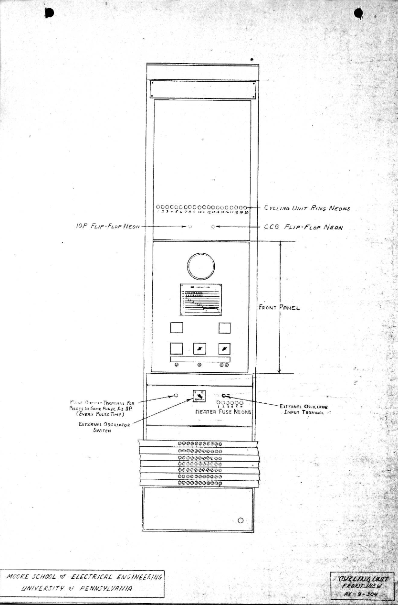

# 8. Control and Sequencing

> Descrição da Imagem: Fotografia dos painéis de controle e sincronização do ENIAC na parede esquerda da sala de máquinas, operados por duas programadoras. Da esquerda para a direita, alinham-se os módulos centrais de sequenciamento da arquitetura: o primeiro painel abriga a Unidade Iniciadora (evidenciando a placa de identificação no topo, os medidores analógicos de tensão e os botões de partida e limpeza geral); o segundo painel contém a Unidade Cíclica (reconhecível pela tela circular do osciloscópio de monitoramento do clock de 100 kHz); o terceiro e o quarto painéis formam o Programador Mestre (onde a operadora à direita ajusta as chaves rotativas de controle de loops e bifurcações sobre feixes de cabos de manobra); e, no canto direito, observa-se uma Tabela de Funções portátil repleta de interruptores de constantes. Na base da instalação, estendem-se as calhas metálicas horizontais com os receptáculos circulares de controle (Program Trays), responsáveis por conduzir os pulsos que coordenavam a execução de toda a máquina.

## 8.1 Initiating an Operation

### 8.1.1 Initiating Unit

> Descrição da Imagem: Desenho técnico oficial da face frontal da Unidade Iniciadora (rotulada originalmente como Initiating Device). A organização dos componentes distribui-se em níveis funcionais de cima para baixo:
> 1. Placa e Medidores Analógicos: No topo, abaixo da placa de identificação da máquina de 1944, localizam-se dois galvanômetros analógicos de painel para leitura das tensões de alimentação contínua e alternada.
> 2. Chaves Seletoras e Matriz de Tensão: Abaixo dos medidores, três chaves rotativas selecionam as linhas elétricas a serem medidas. A chave da esquerda (letras A a H) e a chave central (números 1 a 11) trabalham combinadas com a tabela matricial gravada logo abaixo, permitindo ao operador selecionar e inspecionar até 88 barramentos diferentes de corrente contínua da máquina, enquanto a chave da direita seleciona as fases da rede trifásica de corrente alternada (Vab, Vbc, Vca).
> 3. Controles Primários e Sinalização: Na fileira intermediária, encontram-se os botões de comando da máquina: START e STOP, acompanhados por lâmpadas indicadoras âmbar (máquina operando) e verde (máquina parada), do lado do botão de partida do leitor de cartões (READER START SWITCH) e o botão de disparo manual do pulso inicial (INITIATING PULSE SWITCH).
> 4. Limpeza Geral e Segurança: Abaixo dos botões principais, posicionam-se o botão de limpeza geral (INITIAL CLEAR), a chave disjuntora das fontes de alta tensão (D.C. POWER SUPPLIES), a chave de derivação de segurança (DOOR SWITCH SHUNT, utilizada para ignorar os sensores das portas traseiras durante manutenções técnicas sem desarmar a máquina) e os painéis de junção dos circuitos de intertravamento mecânico do leitor (READER) e da perfuradora (PRINTER).
> 5. Calha e Bornes de Conexão Inferiores: Na base do painel, abaixo da canaleta de proteção de cabos, alinham-se os terminais de controle: seis pares de bornes Ci e Co dedicados à entrada e saída de pulsos de limpeza seletiva, os bornes de intertravamento e sincronização do leitor (Rl, Ri, Ro) e da perfuradora (Pi, Po), e, no canto inferior direito, o borne coaxial Io, ponto físico de saída do pulso de partida para as calhas de programa.

A Unidade Iniciadora centralizava os comandos de energização, supervisão e partida do ENIAC, localizada no primeiro painel da parede esquerda da sala de máquinas. A unidade interligava os comandos manuais dos operadores aos circuitos eletrônicos dos 40 painéis, coordenando a ativação das fontes de energia, a limpeza dos circuitos de cálculo e o disparo do primeiro pulso de controle que colocava o algoritmo em execução. Em suma, em termos modernos, essa unidade era responsável pela sequência de boot do ENIAC.

#### 8.1.1.1 Power Sequencing
A energização do sistema ocorria de forma escalonada para preservar a integridade física das mais de 17.000 válvulas termiônicas da máquina e evitar a queima de filamentos por corrente de surto. Ao ligar a máquina, contatores eletromecânicos de potência acionavam primeiro os sistemas de ventilação (tópico 2.6 Cooling System) e a alimentação de corrente alternada responsável por aquecer os filamentos de todas as válvulas da sala (tópico 2.5 Power Supply and Consumption). O aquecimento prévio dos cátodos metálicos era obrigatório para ativar a emissão termiônica, criando a nuvem protetora de elétrons livres no vácuo antes da aplicação de carga nas placas. Um temporizador térmico mantinha o circuito travado durante um minuto até que todos os tubos atingissem a temperatura ideal de condução, momento em que os contatores liberavam as linhas de alta tensão de corrente contínua para as placas e grades, impedindo o bombardeamento iônico que destruiria a camada emissora de óxido dos cátodos se as placas fossem energizadas a frio.

> Nota: O bombardeamento iônico ocorre porque o vácuo dentro das válvulas não é absoluto, restando traços residuais de gases. Quando a alta tensão contínua é aplicada na placa com o cátodo ainda frio, o campo elétrico acelera violentamente esses íons gasosos positivos em direção ao cátodo. Como o metal frio ainda não formou a nuvem de elétrons livres da emissão termiônica (que funcionaria como uma blindagem de carga espacial), os íons colidem em alta velocidade diretamente contra a superfície do cátodo. Esse impacto contínuo arranca fisicamente a camada microscópica de óxidos de bário e estrôncio responsável pela emissão de elétrons (fenômeno conhecido como decapagem do cátodo ou cathode stripping), inutilizando a capacidade condutiva da válvula de forma irreversível.

A liberação manual das fontes após a expiração do temporizador térmico dependia da chave D.C. POWER SUPPLIES no painel frontal, que comutava a alimentação das bobinas dos contatores principais. Para viabilizar testes com o sistema energizado, a unidade incorporava a chave de derivação de segurança DOOR SWITCH SHUNT. Ao ser comutada, essa chave aplicava um desvio elétrico sobre os sensores instalados nas portas traseiras dos racks (Back Cover Switch Shunt), permitindo que a equipe abrisse os painéis e fizesse medições em circuitos sob alta tensão sem que os sensores mecânicos desarmassem a alimentação das placas.

Além do acionamento programado, a Unidade Iniciadora integrava o circuito de intertravamento de segurança e emergência da máquina. Se os exaustores superiores falhassem ou filtros de ar ficassem obstruídos, chaves mecânicas de fluxo de ar (airflow sail switches) nos dutos de ventilação abriam o circuito de sustentação dos contatores da unidade. O sistema desarmava imediatamente as fontes de alta tensão de corrente contínua para impedir o derretimento de componentes pelo calor acumulado, mantendo apenas a ventilação residual ativa. O mesmo desarme ocorria caso chaves de contato instaladas nas portas traseiras dos racks de alta tensão fossem abertas durante a manutenção.

#### 8.1.1.2 Electrical Monitoring
O monitoramento elétrico da máquina era realizado diretamente no painel frontal por meio de voltímetros acoplados a chaves seletoras rotativas multiposicionais. Essas chaves permitiam ao operador direcionar diferentes barramentos de corrente contínua (como as linhas de polarização de -450 V, -360 V, +150 V e +225 V) e de corrente alternada para o mesmo instrumento de medição, validando a estabilidade das tensões de todas as unidades antes da execução dos cálculos. Ao lado dos medidores, o painel continha chaves de limpeza seletiva, que permitiam enviar sinais de reset para grupos específicos de Acumuladores sem apagar os dados dos demais módulos, possibilitando a reinicialização manual de variáveis intermediárias durante testes ou etapas de repetição algorítmica.

O sistema de medição da máquina utilizava uma tabela matricial gravada no centro do painel contendo linhas de A a H e colunas de 1 a 11, totalizando 88 pontos de teste distribuídos por toda a instalação. Ao posicionar a chave seletora de letras em uma linha e a chave numérica em uma coluna, o operador conectava um barramento de corrente contínua específico diretamente ao galvanômetro esquerdo, permitindo verificar os níveis de polarização de qualquer unidade da sala a partir de um único ponto central. A chave seletora à direita conectava o segundo galvanômetro às três fases da rede de alimentação de corrente alternada (VAB,VBC,VCA), garantindo que as tensões de linha estivessem perfeitamente equilibradas antes da partida dos motores de ventilação e transformadores de filamento.

A base do painel abrigava seis pares de bornes rotulados como Ci (Clear Input) e Co (Clear Output), que permitiam integrar a limpeza seletiva diretamente à programação por cabos. Ao inserir um cabo flexível em Ci, um pulso de controle emitido durante o cálculo acionava os relés de limpeza apenas do grupo de Acumuladores associado àquele borne, com o sinal emergindo no terminal Co para engatilhar a etapa seguinte da equação, automatizando a reinicialização de variáveis intermediárias dentro do próprio fluxo do algoritmo.

#### 8.1.1.3 Remote Control

> Descrição da Imagem: Documento técnico original que detalha em duas seções a estrutura da caixa de controle remoto e suas interfaces de alimentação:
>
> À esquerda, o diagrama ilustra o painel frontal da caixa portátil de controle (Stop Box), projetada para duplicar os comandos centrais da Unidade Iniciadora. A face do dispositivo agrupa seis botões industriais de controle: START e D.C. OFF na fileira superior, INITIAL CLEAR e STOP na fileira intermediária, e READER START SWITCH e INITIATING PULSE SWITCH na fileira inferior. Entre as fileiras de botões, alinha-se uma régua com cinco lâmpadas piloto coloridas (azul, âmbar, opala, verde e vermelha) que forneciam sinalização visual imediata do estado elétrico e operacional do computador à distância.
>
> À direita, a vista complementar detalha a caixa de conexões de utilidades associada, contendo quatro interruptores e tomadas de corrente alternada de 110 V para acionamento dos motores do leitor e da perfuradora IBM, além de receptáculos de reserva preparados para integração de periféricos sobressalentes. Uma nota técnica na base confirma que todos os interruptores e lâmpadas desta unidade operavam em paralelo direto com o painel frontal principal da Unidade Iniciadora.

Para coordenar o funcionamento da máquina ao longo dos 180 metros quadrados da sala, a Unidade Iniciadora continha uma tomada conectada por cabo umbilical a uma caixa de controle remoto portátil (Stop Box). Esse dispositivo manual continha botões de início e congelamento de cálculo, permitindo que a equipe acompanhasse visualmente o movimento dos cartões ou a iluminação das lâmpadas neon em qualquer painel distante enquanto controlava a partida e a parada do processamento.

A capacidade da caixa de controle remoto (Stop Box) de paralisar o computador sem perder os dados calculados baseava-se na retenção estática dos circuitos biestáveis acoplada ao corte do sinal de sincronismo. Como os 20 Acumuladores mantinham seus valores numéricos por meio de tensões contínuas fixas nos contadores de anel, a suspensão do fluxo de dados não provocava o apagamento das informações na memória da máquina, desde que a alimentação das placas e filamentos continuasse ativa.

Ao pressionar o botão de parada na caixa portátil, o circuito comutava um relé rápido que polarizava negativamente a grade de uma válvula pentodo de controle na Unidade Iniciadora, funcionando como uma chave que interrompia a passagem do pulso mestre de programa (CPP) gerado no tempo 17/20 do ciclo de adição. A operação aritmética que estivesse em andamento naquele microssegundo completava seu ciclo normal de 200 microssegundos, mas o pulso de saída que deveria viajar pelos cabos para engatilhar o painel seguinte era fisicamente retido na comporta bloqueada. O sistema entrava em um estado de congelamento temporal completo, mantendo as lâmpadas neon acesas indicando os valores intermediários nas paredes da sala até que o operador pressionasse o botão de partida, o que despolarizava a válvula de corte e permitia que o próximo pulso CPP retomasse a cadeia de operações exatamente da coordenada onde havia parado.

Além da extensão portátil, o painel da Unidade Iniciadora abrigava os botões locais START e STOP, acompanhados por lâmpadas indicadoras de status do sistema. O acionamento do botão START liberava o tráfego de pulsos e acendia a lâmpada piloto âmbar, indicando máquina em execução, enquanto o botão STOP bloqueava a comporta do sinal mestre e acendia a lâmpada piloto verde, confirmando o estado de parada do computador. Ao lado desses comandos, a chave READER START SWITCH permitia engatar a embreagem mecânica do Leitor de Cartões de forma independente do algoritmo eletrônico, procedimento utilizado pelos operadores para tracionar e posicionar o primeiro cartão do lote sob as escovas de leitura antes de iniciar o processamento da equação.

#### 8.1.1.4 I/O Interlocking
A unidade também abrigava circuitos de intertravamento dedicados ao Leitor de Cartões e à Perfuradora IBM, bloqueando o avanço do processamento eletrônico se os periféricos mecânicos estivessem sem alimentação, sem cartões no alimentador ou no meio de um ciclo de tração de papel. Esse circuito sincronizava a velocidade de 100 kHz dos circuitos eletrônicos com o ritmo mecânico das máquinas da IBM, que levavam 0,6 segundo por cartão. Quando o programa alcançava uma etapa de leitura ou perfuração, o pulso de controle acionava um circuito biestável na Unidade Iniciadora que bloqueava a comporta de emissão do pulso mestre (CPP), congelando o avanço do algoritmo eletrônico.

Simultaneamente, a unidade acionava a embreagem mecânica do leitor ou da perfuradora por meio de relés. Se o periférico apresentasse falhas durante o processo, como falta de papel no alimentador, atolamento no trajeto de transporte ou gaveta de saída cheia, chaves mecânicas de segurança (Feed Interlock Switches) abriam o circuito elétrico e mantinham a comporta da Unidade Iniciadora travada, impedindo que a máquina executasse cálculos sobre dados inexistentes. Quando o cartão completava seu deslocamento sob as matrizes de corte ou escovas de leitura, um came mecânico acoplado ao eixo do motor da IBM fechava um contato elétrico final. Esse fechamento enviava um sinal contínuo pelo cabo umbilical de volta à Unidade Iniciadora, que desarmava o biestável de bloqueio, reabria a comporta eletrônica e liberava o pulso de controle para retomar a computação nas calhas de programa.

A interligação desse sistema de segurança mecânica com a programação ocorria através dos bornes coaxiais na base da Unidade Iniciadora. O borne Ri (Reader Input) recebia o pulso de programa que solicitava a leitura de um novo cartão, enquanto o terminal Rl recebia a linha de sinal dos sensores de papel do alimentador, mantendo o circuito eletrônico travado se houvesse falhas mecânicas. Ao final do deslocamento do papel, o contato de fim de ciclo emitia o pulso de liberação através do borne Ro (Reader Output), de onde um cabo coaxial conduzia o sinal de volta às calhas de controle para retomar os cálculos, com uma pinagem idêntica disponível para a perfuradora através dos terminais Pi (Printer Input) e Po (Printer Output).

### 8.1.2 Initial Clear
Durante a energização da máquina, os circuitos biestáveis acordavam em configurações aleatórias devido a pequenas assimetrias térmicas e capacitivas entre os tríodos de cada válvula, fazendo com que contadores decádicos exibissem números residuais e flip-flops de programa ativassem rotinas desordenadas antes mesmo do comando de partida. A neutralização desses estados ocorria pelo acionamento do botão de limpeza geral (Initial Clear) no painel da Unidade Iniciadora, que energizava um conjunto de relés eletromecânicos de controle (relés H, K, 3 e 4) responsáveis por gerar o sinal contínuo denominado Initial Clear Gate (ICG).

Esse processo de limpeza ocorria tanto de forma manual, pelo acionamento do botão no painel pelo operador, quanto de forma automática durante o procedimento de partida. Circuitos de retardo resistivo-capacitivo (R-C) na Unidade Iniciadora disparavam os relés do ICG no exato instante em que os contatores de corrente contínua terminavam de aplicar as altas tensões nas placas, garantindo que a máquina jamais permanecesse energizada com valores lógicos indefinidos.

#### 8.1.2.1 Synchronizing Cabling
A distribuição do ICG por todos os 40 painéis da sala dependia das calhas de sincronização (Synchronizing Trays), canaletas metálicas de aço instaladas horizontalmente na parte traseira intermediária dos painéis, posicionadas longe dos barramentos de corrente alternada da base para evitar que a indução eletromagnética da rede de 60 Hz gerasse ruídos nas linhas lógicas. O feixe condutor interno (Synchronizing Trunk) era composto por linhas individuais de cobre de baixa resistência com isolamento dielétrico espesso e blindagem metálica trançada conectada ao terra, interligando os módulos por meio de conectores multipinos de baquelite nas junções de cada painel. Esse tronco concentrava todas as vias de temporização contínua da Unidade Cíclica, reservando condutores dedicados exclusivamente para o tráfego do ICG.

#### 8.1.2.2 Initial Clear Gate

> Descrição da Imagem: Documento técnico oficial de uma tabela de . tabela organiza-se em três colunas mapeando a unidade funcional (Unit), o circuito interno correspondente (Item) e o mecanismo elétrico de restauração (Manner of Initial Clearing or Resetting). O registro detalha o protocolo de purgação comandado pelo sinal Initial Clear Gate (ICG) em toda a arquitetura: nos Acumuladores, o ICG libera o sinal de porta CCG para zerar os contadores de anel decádicos e o biestável de sinal PM; no Programador Mestre, o ICG bloqueia as comportas de saída para extinguir pulsos residuais nas calhas, forçando os contadores de passo (steppers) para o estágio 1 e as décadas ordinárias para o estágio 0; no Divisor e nas Tabelas de Função, os anéis de controle são restaurados para seus pontos de partida pré-definidos (estágios A e -3, respectivamente); e nos módulos periféricos do Leitor e da Perfuradora IBM, os flip-flops de partida e de intertravamento síncrono são desligados por pulsos CPP liberados pelo ICG para impedir o acionamento mecânico indevido durante a partida.

A anatomia do Initial Clear Gate consistia em um sinal contínuo mantido em nível alto durante um intervalo entre 0,2 e 0,5 segundo, tempo determinado pela mecânica de retenção dos relés de partida para cobrir centenas de ciclos de adição e garantir a estabilização completa da máquina. Em estado de repouso, a linha condutora do ICG permanecia polarizada com uma tensão negativa de corte de -360 V. Ao pressionar o botão de limpeza, os relés comutavam a linha abruptamente para o potencial de terra (0 V), produzindo uma onda quadrada contínua com uma variação de potencial positivo de centenas de volts que se propagava por toda a extensão do Synchronizing Trunk.

Ao atingir os painéis individuais, essa elevação de tensão do ICG era aplicada diretamente às grades de controle das válvulas de potência de limpeza (como os tubos 6L6 do chassi PM & Clear dos Acumuladores), fazendo essas válvulas conduzirem corrente em saturação máxima. Essa descarga forçava a grade do biestável do estágio 0 a entrar em condução enquanto bloqueava os estágios de 1 a 9 em corte, redefinindo todas as décadas do anel simultaneamente para o número zero. Caso a chave de figuras significativas do painel estivesse posicionada para arredondamento matemático, o circuito desviava a conexão interna para travar a condução diretamente no estágio 5.

Simultaneamente, o ICG atingia o Programador Mestre, onde forçava todos os circuitos contadores de passo (steppers) para o estágio 1 e bloqueava as comportas de saída de programa, impedindo a passagem de sinais para as calhas frontais e permitindo que qualquer pulso residual circulando pelo sistema se dissipasse nas cargas resistivas. Com a despolarização dos receptores de programa em todas as unidades e a estabilização das linhas de dados no potencial de repouso, os relés do ICG desarmavam, restaurando a linha de sincronização para -360 V e acendendo a lâmpada indicadora de status ("Ready") na Unidade Iniciadora para autorizar o início dos cálculos.

> Nota: Diferente dos Acumuladores, cujos anéis decádicos representavam grandezas numéricas absolutas (iniciando do zero), os Steppers do Programador Mestre funcionavam como contadores de repetição de laços (loops). Cada posição do stepper correspondia a uma iteração ordinal da sub-rotina. Como não existia a concepção de uma "iteração zero", o circuito biestável era fisicamente polarizado para que a limpeza forçasse o estágio 1 como o ponto de partida padrão, garantindo que o algoritmo entrasse imediatamente no primeiro ciclo do loop.

### 8.1.3 Initiating Pulse

> Descrição da Imagem: Esquema elétrico de um circuito mapeia a arquitetura interna do módulo plugável responsável por converter o acionamento mecânico do botão de partida no primeiro pulso de programa do ENIAC. Da esquerda para a direita, o diagrama divide-se em blocos funcionais sequenciais: os estágios iniciais de padronização (Pulse Standardizer, tópico 3.2.5) e o biestável assíncrono (Unsynchronized Flip-Flop, tubos 63 a 65) eliminam os repiques transitórios do contato físico; a comporta de sincronismo (Sync. Gate, tubo 66) e o biestável síncrono (Synchronized Flip-Flop, tubos 67 e 68) interceptam o sinal mestre CPP emitido no tempo 17/20 pela Unidade Cíclica; e o estágio final de transmissão (Transmitter, tubos 70 a 72, constituído por válvulas de potência 6L6) gera a onda quadrada padronizada de 2 microssegundos direcionada ao borne frontal Io para deflagrar o algoritmo.

Após a conclusão da limpeza geral, o processamento iniciava pelo acionamento do botão de partida no painel frontal ou na caixa de controle remoto portátil. A conversão desse comando manual em um sinal elétrico compatível com a eletrônica da máquina ocorria no módulo plugável gerador de pulso de partida. Esse módulo consistia em uma gaveta metálica removível dotada de conectores traseiros multipinos tipo faca para encaixe rápido no painel da Unidade Iniciadora. Os circuitos internos desse chassi agrupavam um relé industrial Western Electric para interfacear o botão, uma válvula duplo-tríodo 6SN7 configurada como biestável para absorver o repique mecânico do contato e válvulas de chaveamento e potência responsáveis por modular e amplificar o sinal de saída.

O pulso de partida gerado pela unidade era eletricamente idêntico aos pulsos de programa (Program Pulses) que circulavam pela máquina durante os cálculos. O fechamento mecânico do botão comutava o relé, que disparava o biestável interno para aplicar uma tensão contínua na grade de uma válvula pentodo, abrindo uma comporta eletrônica que interceptava a linha do pulso mestre de controle, gerado continuamente pela Unidade Cíclica no tempo 17/20 de cada ciclo de adição. A chegada do CPP atravessava a comporta aberta e acionava uma válvula de potência que restaurava as bordas da onda, gerando um pulso com duração exata de 2 microssegundos e uma variação de potencial elétrico de -345 V em repouso para -290 V durante o pico de condução. Esse mesmo disparo comutava o biestável de volta ao estado de repouso, fechando a comporta eletrônica imediatamente para impedir a passagem de pulsos nos ciclos subsequentes até que o operador soltasse e pressionasse o botão físico novamente.

> Nota: A largura temporal de 2 microssegundos para os pulsos de controle e de dígitos derivava diretamente do ciclo fundamental da Unidade Cíclica. Como o oscilador mestre operava a 100 kHz, cada intervalo básico de tempo durava exatamente 10 microssegundos. O pulso ativo de trabalho ocupava os primeiros 2 microssegundos desse intervalo (tempo em que a linha subia para -290 V), enquanto os 8 microssegundos restantes em potencial de repouso (-345 V) forneciam a folga temporal necessária para a dissipação de cargas capacitivas e a estabilização das grades das válvulas antes da chegada do intervalo seguinte.

Esse sinal de disparo saia do painel frontal da Unidade Iniciadora através do borne coaxial blindado rotulado como Io​ (Initiating output). A condução do sinal ocorria por cabos coaxiais flexíveis protegidos por uma malha de cobre trançada conectada ao terra e terminados em plugues de retenção por rosca, preservando as bordas retangulares da onda e evitando a indução de ruídos em linhas adjacentes. O cabo de manobra podia ser conectado diretamente a uma via da calha de programa frontal (como a linha Program Line 1-1) ou inserido na tomada de entrada de controle da primeira unidade lógica designada pelo operador, como a Unidade de Transmissão de Constantes para iniciar a leitura de cartões ou o Programador Mestre para configurar os contadores de passo. A função do pulso de partida limitava-se a engatilhar essa primeira unidade da sequência da equação, pois, ao concluir sua tarefa local, a unidade executora liberava o CPP do ciclo corrente para seu próprio terminal de saída de programa, transferindo o controle para o painel subsequente e mantendo o processamento em cadeia sem novas emissões da Unidade Iniciadora.

> Descrição da Imagem: Fotografia dos dois painéis de comando da parede esquerda da máquina com Harry Huskey operando os controles da Unidade Cíclica. À esquerda, observa-se a face frontal da Unidade Iniciadora (detalhada no diagrama no topo desse tópico), exibindo os galvanômetros superiores, a tabela matricial de medição de tensões contínuas e os botões centrais de controle e partida. À direita, posiciona-se a Unidade Cíclica, evidenciando a tela circular do osciloscópio de raios catódicos no topo e a placa gráfica com o diagrama temporal dos trens de pulso padronizados logo abaixo. O operador manuseia a chave seletora inferior de modos de operação, responsável por alternar a emissão do clock entre os modos Contínuo, Ciclo Único de Adição ou Pulso Único. Na base de ambos os painéis, múltiplos cabos de manobra partem dos terminais coaxiais inferiores e conectam-se diretamente às calhas das bandejas de programa, evidenciando a interligação dos circuitos de sincronismo e inicialização que colocavam o restante do computador em movimento.

## 8.2 Cycling Unit
- Geração dos pulsos fundamentais para sincronizar a máquina

> Descrição da Imagem: Desenho técnico oficial da face frontal da Unidade Cíclica. No topo, destaca-se a abertura circular para a tela do osciloscópio de raios catódicos, utilizado no monitoramento dos sinais do clock de 100 kHz. Logo abaixo, a placa de referência "CYCLING UNIT PULSES AND GATES" ilustra o diagrama temporal dos 20 intervalos de 10 microssegundos do ciclo básico de adição, mapeando os trens de pulso padronizados (CPP, 10P, 9P, 1P a 4P, CCG e RP). Na seção inferior, localizam-se os controles de operação, à direita, a chave seletora ("OPERATION") que alterna entre os modos de execução Contínuo (CONT.), Ciclo Único de Adição (1 ADD.) e Pulso Único (1 PULSE); ao centro, a chave seletora de entrada do osciloscópio ("OSCILLOSCOPE INPUT"), usada para inspecionar cada forma de onda individualmente; e, à esquerda, o botão de avanço passo a passo ("1 PULSE & 1 ADDITION"), utilizado para testes e depuração de cálculos. Na base, os terminais PA, EXT., 1A e CONT. permitiam a conexão de extensões de controle remoto e equipamentos externos de calibração.

> Descrição da Imagem: 

> Descrição da Imagem: 

## 8.3 Master Programmer
- Mestre da operação, controlava a sequência, os loops e as iterações

## 8.4 Stepper Counters
- Como a máquina acompanhava as iterações dos loops 

## 8.5 Conditional Branching
- Como a máquina alterava o fluxo de operações com base em um resultado positivo ou negativo

## 8.6 Absence of Fetch-Decode-Execute
- Por que o ciclo moderno de busca, decodificação e execução não se aplica

## 8.7 Operation Sequence
- Diagrama lógico, passo a passo, de como as operações eram encadeadas e detalhamento do processo
(Add image)