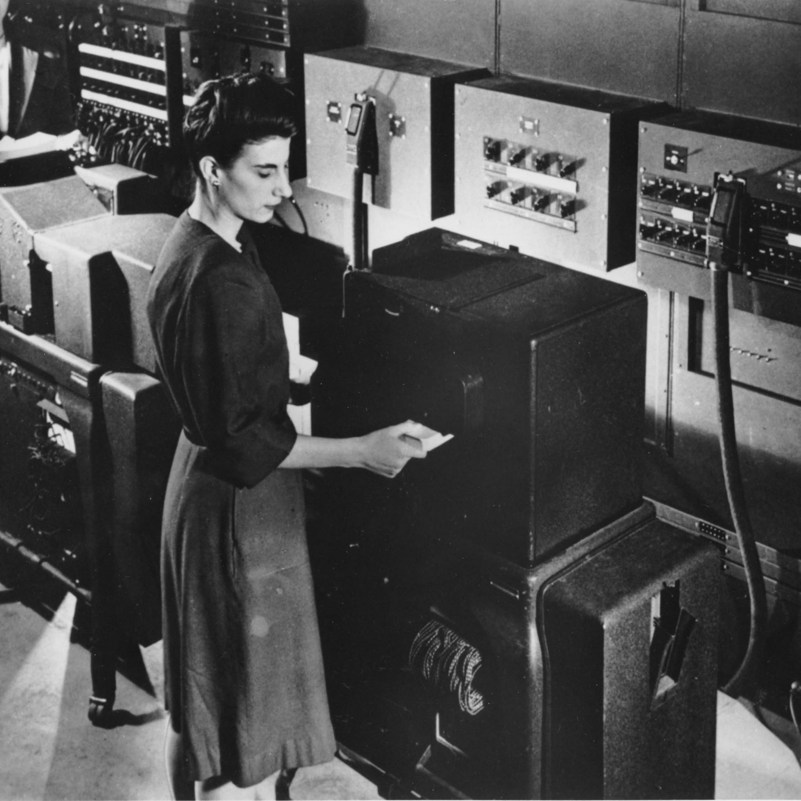

# 11. Operation

## 11.1 Input
A entrada do ENIAC, ou *Input*, corresponde às informações introduzidas no computador para viabilizar a execução dos cálculos. Enquanto computadores modernos recebem dados por meio de teclados, mouses, telas sensíveis ao toque ou arquivos digitais em rede, o ENIAC não possuía nenhum periférico interativo desse tipo. Toda inserção de informações acontecia de maneira física, apoiada principalmente em cartões perfurados de papel cartonado e no ajuste manual de chaves rotativas.

No que diz respeito ao conteúdo introduzido no sistema, a entrada do ENIAC era estritamente voltada ao fornecimento de **operandos numéricos brutos** (como parâmetros iniciais, medições e dados de entrada de um problema) e de **constantes matemáticas**. Diferentemente dos computadores atuais, o sistema de entrada não carregava instruções de software, pois a lógica de programação era configurada diretamente no hardware por meio do rearranjo físico de cabos e interruptores nos painéis da máquina.

> Nota: Um operando é o valor numérico bruto sobre o qual uma operação matemática é aplicada. No contexto do ENIAC, é mais preciso referir-se a esses dados como operandos em vez de variáveis, uma vez que o computador não possuía endereçamento de memória: os valores não eram salvos em endereços simbólicos, mas sim roteados diretamente por cabos até os contadores de anel dos acumuladores.

De modo geral, a entrada de dados por cartões seguia três etapas integradas. Primeiro ocorria a preparação externa, na qual os valores numéricos eram perfurados em cartões de papel por máquinas auxiliares. Em seguida, um leitor eletromecânico da IBM identificava as perfurações e convertia esses dados em estados elétricos mantidos temporariamente em relés. Por fim, quando o cálculo requisitava os valores, circuitos eletrônicos convertiam esses estados em trens de pulsos sincronizados ao relógio de 100 kHz da Unidade Cíclica, enviando-os pelos barramentos de dígitos até os acumuladores.

### 11.1.1 Punched Cards
Para introduzir grandes volumes de operandos, utilizavam-se cartões perfurados padrão da IBM (cartões Hollerith) feitos de papel cartonado rígido, resistentes o bastante para suportar a tração mecânica sem rasgar ou amassar. Cada cartão era organizado em uma grade de 80 colunas verticais e 12 linhas horizontais: as dez linhas inferiores representavam os dígitos de 0 a 9, enquanto as duas linhas superiores, chamadas de linhas de zona (11 e 12), serviam para codificar sinais e caracteres especiais. Para indicar um número negativo, realizava-se um furo adicional na linha de zona 11 da coluna reservada ao sinal do operando; na ausência desse furo, o valor era interpretado como positivo. Além disso, todo cartão contava com um corte diagonal em um dos cantos superiores, permitindo identificar visualmente caso alguma unidade tivesse sido inserida invertida no lote.

A confecção desses cartões não era feita pelo ENIAC, mas por máquinas eletromecânicas externas da IBM chamadas *Keypunches* (como os modelos Type 032 e, posteriormente, IBM 026). Nessas máquinas, semelhantes a uma escrivaninha com teclado integrado, cada tecla acionava lâminas de aço que perfuravam retângulos no cartão coluna por coluna, imprimindo também o caractere correspondente no topo do papel. Como não era possível desfazer um furo incorreto, qualquer erro exigia descartar o cartão defeituoso e utilizar a estação de leitura da própria *keypunch* para duplicar automaticamente as colunas anteriores já corretas para um novo cartão em branco.

Para transferir esses dados ao ENIAC, os lotes preparados eram inseridos no *IBM Card Reader*, uma máquina contábil da série 400 adaptada para atuar como leitora de entrada. O equipamento tracionava um cartão por vez, da borda dos 9s até as linhas de zona, entre um cilindro metálico eletrificado e uma fileira de 80 escovas metálicas. Como o papel cartonado é isolante, a corrente elétrica só fechava circuito quando um furo passava sob uma escova, gerando um sinal que viajava por um cabo umbilical até o Painel 3 da unidade conhecida como *Constant Transmitter* (Transmissor de Constantes). Nesse painel, um banco de relés eletromecânicos travava mecanicamente e mantinha armazenados até 80 dígitos e 16 sinais algébricos de um cartão, disponibilizando-os em seguida para válvulas pentodo que os convertiam em pulsos eletrônicos sob demanda do programa.

> Nota: O *Constant Transmitter* atuava como um *buffer* eletromecânico indispensável entre o *IBM Card Reader* e o núcleo eletrônico do ENIAC. Como o leitor mecânico operava de forma lenta e totalmente dessincronizada em relação ao ciclo eletrônico de 200 microssegundos da máquina, os relés do Painel 3 seguravam os valores do cartão de modo estável até que a Unidade Cíclica e os pulsos de programa os liberassem para os acumuladores.

### 11.1.2 Rotary Switches
Nem todo operando precisava passar pela leitura mecânica de cartões. Para evitar o desperdício de tempo com valores fixos utilizados repetidamente ao longo de um cálculo (como constantes matemáticas ou coeficientes físicos), os Painéis 1 e 2 do *Constant Transmitter* operavam de forma independente do leitor de cartões.

Esses painéis eram equipados com matrizes de chaves rotativas manuais numeradas de 0 a 9, permitindo que os operadores configurassem fisicamente até 20 dígitos numéricos e 4 sinais diretamente no hardware. Ao acionar uma constante definida nessas chaves, as válvulas transmissoras liam a tensão contínua diretamente dos contatos manuais e geravam os pulsos digitais na mesma lógica de coincidência aplicada aos relés, entregando os dados fixos em velocidade eletrônica e sem gargalos mecânicos.

### 11.1.3 Main Limitations
A entrada de dados do ENIAC apresentava limitações expressivas quando comparada à velocidade de seu processamento interno. O principal gargalo residia na natureza eletromecânica da leitura de cartões: enquanto as válvulas executavam milhares de operações por segundo, o deslocamento físico do papel e o acionamento de relés impunham pausas longas sempre que novos lotes de operandos precisavam ser carregados.

Somavam-se a isso a dependência de máquinas externas da IBM para perfurar, conferir e reordenar os cartões, o trabalho manual demorado para digitar pilhas extensas ou ajustar chaves rotativas sem cometer erros e a vulnerabilidade a falhas físicas de manuseio. Como o leitor não verificava a orientação do texto impresso, qualquer cartão invertido ou fora de ordem comprometia os dados enviados ao cálculo caso escapasse à conferência visual dos operadores. Por fim, não havia entrada interativa em tempo real, exigindo que todos os parâmetros iniciais estivessem devidamente preparados antes da execução.

> Nota: Enquanto o ENIAC realizava cerca de 5.000 adições por segundo (300.000 por minuto), o *IBM Card Reader* lia aproximadamente 125 cartões por minuto (cerca de 2,08 cartões por segundo, o que equivalia a no máximo 1.000 valores numéricos de 10 dígitos por minuto). Por conta dessa disparidade, a resolução dos problemas precisava ser planejada para exigir o menor número possível de leituras de cartões durante o processamento.

## 11.2 Configuration
- Como o sistema está configurado nessa operação

## 11.3 Components
- Quais componentes participam da operação

## 11.4 Routing
- Como as informações circulam pelo sistema durante a operação

## 11.5 Operations
- Quais operações são realizadas durante a operação principal

## 11.6 Output
A saída do ENIAC, ou Output, é a informação gerada pelo computador sendo transmitida para o usuário. Nos computadores modernos, o Output pode ser feito pelo monitor ou por uma impressora, por exemplo. Já no ENIAC, a saída era feita de maneira física, por cartões perfurados.

O processo do ENIAC era dividido em 3 etapas:
1. Processamento de informações, onde o computador realizava as operações matemáticas.
2. Registro físico, onde a informação era repassada para a Punch Card Machine, que perfurava os cartões para representar os valores numéricos.
3. Apresentação dos resultados, onde uma tabuladora lia o cartão perfurado de saída e traduzia os valores em papel.

> Obs.: Esse processo dividido em 3 etapas era importante, pois permitia que o ENIAC continuasse processando informações e executando operações enquanto registrava a saída (output) de outros dados.

### 11.6.1 Cartões Perfurados
Os cartões perfurados eram feitos de papel-cartão rígido com 80 colunas. Cada coluna continha 12 posições de perfuração e as linhas eram nomeadas em:
12, 11, 0, 1, 2, 3, 4, 5, 6, 7, 8 e 9

Assim, se fôssemos representar o valor 415, utilizaríamos 3 colunas com perfurações nas linhas 4, 1 e 5, respectivamente. 

Ademais, não era o próprio ENIAC que perfurava os cartões de saída, mas sim o equipamento de perfuração de cartões da IBM, conhecido como Summary Punch.

O passo a passo da impressão da saída era a seguinte:
1. O ENIAC realizava a operação e guardava os resultados nos acumuladores.
2. Uma unidade chamada Printer recebia a informação dos resultados que serão enviados para a saída.
3. A Printer enviava esses dados para um relés eletromecânico que armazenava os dados e enviava os sinais para a IBM Summary Punch.
4. A IBM Summary Punch fazia as perfurações no cartão, com os dados que a foram enviados.
5. O cartão era enviado para a pilha de saída, onde era lido, armazenado ou recolocado à entrada (input) do ENIAC para dar início à novas operações.

> Obs.: A Printer, apesar de ser traduzida "impressora", não imprimia nada. Essa unidade, na verdade, preparava os dados para saída e controlava o equipamento externo de perfuração.

### 11.6.2 Principais limitações
Como limitações da saída do ENIAC, podemos citar diversos fatores, tais quais:
1. Velocidade eletromecânica. Apesar do processamento do ENIAC ser extremamente rápido, a perfuração dos cartões era muito mais lenta.
2. Capacidade de armazenamento. Os cartões continham número limitado de valores que podiam armazenar, gerando diversas pilhas de cartões para algumas operações.
3. Dependência de equipamentos externos. A impressão dos resultados exigia uma máquina tabuladora separada.
4. Organização manual. Devido à saída física, é necessário o manejo de pilhas de cartões perfurados, o transporte e a organização em ordem adequada.
5. Ausência de visualização moderna, como um monitor ou tela, que mostrasse o resultado imediatamente.

> Obs.: Enquanto o ENIAC conseguia executar 5.000 adições por segundo, a perfuradora registrava aproximadamente 100 cartões por minuto, sendo cerca de 1,67 cartões por segundo. 
> Vale citar que um cartão não equivale à uma adição, mas ainda assim a discrepância segue sendo muito grande.

- Como o resultado é produzido
